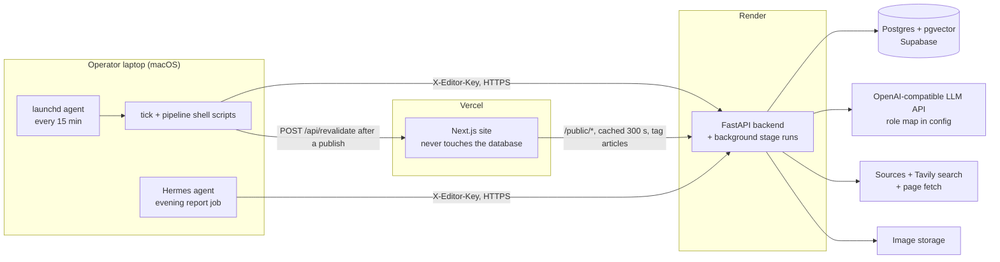
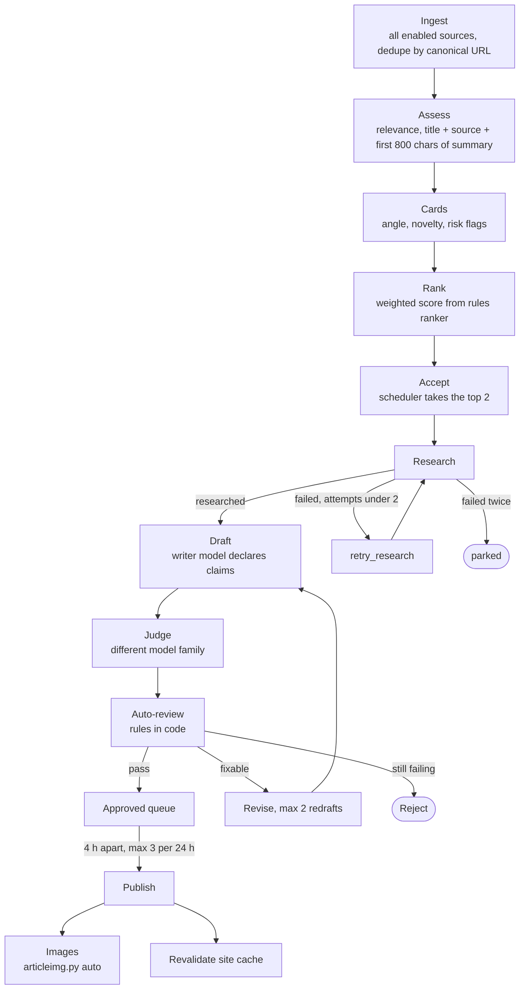

# SignalForge architecture

How the system is put together, where each part runs, and how an article moves from a raw signal to a published page. For the reasoning behind the design see [README.md](README.md). For running it on a new machine see [docs/hermes-setup.md](docs/hermes-setup.md). For the agent-facing API see [docs/pipeline/agent-api.md](docs/pipeline/agent-api.md).

## 1. Where things run

- **Backend** (Render): FastAPI app in `apps/api`. Long stages run in a background thread, one at a time (a second start returns 409).
- **Database** (Supabase Postgres, pgvector). Migrations with Alembic in `src/signalforge/db/migrations`. Run `alembic upgrade head` before deploying code that needs a new column.
- **Website** (Vercel): Next.js in `apps/web`. It reads only the public API. Article lists are cached for 300 s under the tag `articles`; the scheduler expires that tag after a publish.
- **Scheduler** (laptop): launchd runs `scripts/hermes/signalforge_cron_tick.sh` every 15 minutes. It tries to publish a queued draft each time, and runs the full pipeline once per 6-hour slot (00, 06, 12, 18 local), catching up if the laptop was off.
- **Hermes** (laptop): an agent with one revocable key. Only its evening job is enabled. It reports the day, attaches missing images, and lists parked cards. It never blocks the pipeline.

## 2. Code layout

| Path | Responsibility |
|---|---|
| `src/signalforge/core` | Protocols (source, search, LLM, ranker, publisher), artifacts (typed hand-offs), budgets, retries, errors. Imports nothing from stages or plugins. |
| `src/signalforge/plugins` | Implementations chosen by config: `sources/` (arXiv, Hacker News, Hugging Face papers and models, RSS, GitHub, Lobsters, dev.to), `search/` (Tavily, direct page fetch), `rankers/`. |
| `src/signalforge/llm` | Gateway, provider clients, registry and the role to model map. Embeddings can be split into one text per request (`LLM_EMBED_BATCH_SIZE`). |
| `src/signalforge/stages` | One module per stage; each takes and returns typed artifacts. |
| `src/signalforge/verticals` | YAML config per topic area (`ai_engineering.yaml`): sources, queries, lookback. |
| `src/signalforge/db` | SQLAlchemy models, repositories, Alembic migrations. |
| `src/signalforge/pipeline_state.py` | One pure function that maps stored statuses to a card's `stage` and single `next_action`. |
| `src/signalforge/auto_review.py`, `publish_pacing.py`, `publishing.py` | Review rules, publish pacing, publishing. |
| `apps/api` | HTTP API: `/public/*`, `/editor/*`, `/agent/*`, `/cards/*`, `/signals/*`. |
| `apps/worker` | CLI entry points for each stage and for `tick`. |
| `apps/web` | Next.js site and editor pages. |
| `skills/article-images` | Deterministic SVG cover and figure generator and uploader. |
| `scripts/hermes` | Scheduler scripts, launchd template, install script, Hermes prompt. |
| `scripts/eval_research.py` | Dry-run research evaluation. See [docs/pipeline/eval-research.md](docs/pipeline/eval-research.md). |

## 3. The pipeline

### Research in detail

1. Fetch the primary page. For arXiv papers, read the full HTML (arxiv.org/html, then ar5iv, then the abstract page) and prefer the results and limitations sections. One request per URL. PDF is not read.
2. Collect up to 3 reference links from the primary page (GitHub README, Hugging Face card, arXiv).
3. Run one Tavily search for corroborating or critical sources.
4. Extract claims from each document with the cheap model. A claim survives only if its evidence span is a verbatim substring of the document.
5. Embed and merge near-duplicate claims across documents (similarity at least 0.85); flag likely disagreements (0.60 to 0.85). If the embedding call fails, claims are kept unmerged and research continues.
6. Sufficiency gate: at least 3 claims, otherwise one bounded extra search round. Still short means a failure with a class: `blocked`, `empty`, `no_claims`, `thin`, `budget` or `other`.
7. A card gets at most 2 research attempts (`research_packages.attempts`). After that its `next_action` is `parked`; nothing retries it and the evening report lists it.

### Draft and review

The writer sees only the stored research package and declares claims that point at evidence spans. A mechanical span match runs first, then the judge model checks each sentence. Draft time also derives `kind`, `source_label` and a grounded `headline` (value, unit, direction, takeaway) that the cover uses. Auto-review is pure code: too many flagged sentences or too few verified claims means revise, otherwise flagged sentences are removed. After 2 failed redrafts the card is rejected.

### Publishing

The API enforces pacing: at least 4 hours between articles and at most 3 per rolling 24 hours. The approved queue drains as slots open, from the 15-minute tick as well as from the 6-hour slot. The scheduler accepts two cards per slot so that one failure still leaves a draft. Expect 2 to 3 articles a day; the number drops on days the laptop was off.

### Images

`skills/article-images/scripts/articleimg.py auto` builds a "Signal Steps" cover and a figure for every published article without images. It uses no model: the layout, a pastel from a fixed palette of 13, and the headline fact all come from the stored article, and every number is validated against the article's claims. Colour is seeded per article so neighbouring articles differ. The website falls back to a colour by article kind if an image is missing.

## 4. Models and roles

Stages ask for a role (writer, judge, relevance filter, research extraction, claim embedding), and `core/config.py` plus `llm/roles.py` map roles to models. Any OpenAI-compatible endpoint works. The writer and the judge must be different model families; this is checked before a card is touched. Hermes' own model is separate from the pipeline's models.

## 5. State and the agent interface

`GET /agent/work` returns every card with a `stage` and one `next_action`: `run_research`, `retry_research`, `parked`, `run_draft`, `retry_draft`, `auto_review`, `run_revise`, `publish`, `attach_images`, `human_review`, `wait` or `none`. Write calls (`POST /agent/run/<stage>`, `/agent/drafts/{id}/auto-review`, `/agent/publish-next`) are idempotent and need the revocable editor key. Every decision is stored with an actor (agent or human) and every LLM call with its cost, against a per-card budget.

## 6. Security

- Untrusted page text is wrapped as data and never treated as instructions. Fetching checks URL safety and robots rules.
- Hermes holds one revocable key and no database or storage credentials.
- Secrets live in environment files (`~/.signalforge.env`, `~/.hermes/.env`, Render and Vercel settings), never in the repo.

## 7. Known limits

- Topic ranking still depends on model-estimated numbers, and there is no cross-source clustering or novelty check against published articles. Two accepted cards can cover the same news.
- Most recent articles come from arXiv, because it is the highest-volume source and has no popularity signal.
- Research does not read PDFs.
- Scheduling depends on the laptop being on. A missed slot runs late rather than being lost.
