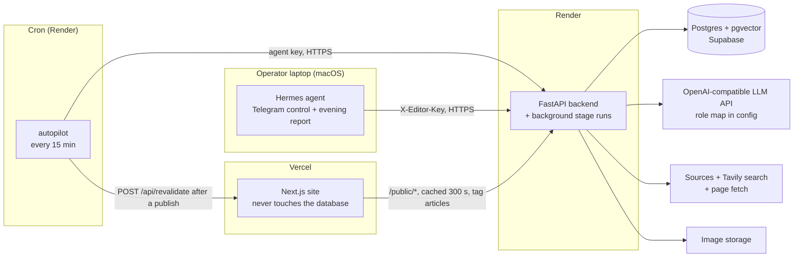
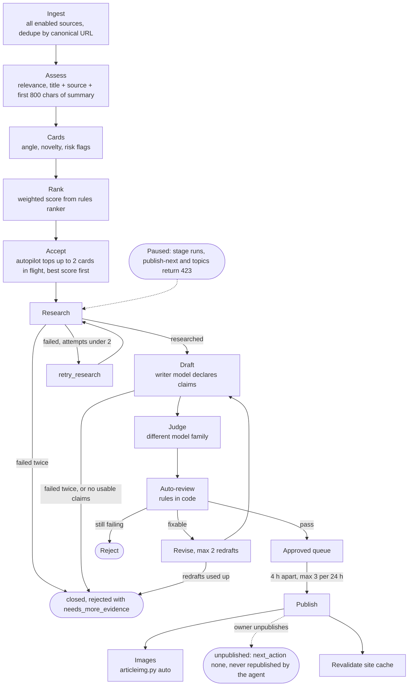

# SignalForge architecture

How the system is put together, where each part runs, and how an article moves from a raw signal to a published page. For the reasoning behind the design see [README.md](README.md). For running it on a new machine see [docs/hermes-setup.md](docs/hermes-setup.md). For the agent-facing API see [docs/pipeline/agent-api.md](docs/pipeline/agent-api.md).

## 1. Where things run

- **Backend** (Render): FastAPI app in `apps/api`. Long stages run in a background thread, one at a time (a second start returns 409).
- **Database** (Supabase Postgres, pgvector). Migrations with Alembic in `src/signalforge/db/migrations`. Run `alembic upgrade head` before deploying code that needs a new column.
- **Website** (Vercel): Next.js in `apps/web`. It reads only the public API. Article lists are cached for 300 s under the tag `articles`; the autopilot expires that tag after a publish.
- **Autopilot** (Render cron job, see [docs/deploy-cron.md](docs/deploy-cron.md)): `python -m apps.worker.autopilot` every 15 minutes. It holds only the agent key. It exits if `GET /agent/controls` says paused. Otherwise it tries to publish a queued draft, makes images, closes dead cards, and runs the full pipeline once per 6-hour slot after claiming the slot lease. After 3 failed attempts on a slot it sends an alert to `ALERT_WEBHOOK_URL`.
- **Hermes** (laptop): an agent with one revocable key. It is the owner's Telegram control (status, pause, resume, publish now, hot and normal topics, `why` an article is not published, the publish queue; see `scripts/hermes/telegram-control.md`) and sends the evening report. It is not the pipeline driver, and it never blocks the pipeline. The launchd scripts in `scripts/hermes` are a fallback only: unload them before the cron is enabled, never run both.

## 2. Code layout

| Path | Responsibility |
|---|---|
| `src/signalforge/core` | Protocols (source, search, LLM, ranker, publisher), artifacts (typed hand-offs), budgets, retries, errors. Imports nothing from stages or plugins. |
| `src/signalforge/plugins` | Implementations chosen by config: `sources/` (arXiv, Hacker News, Hugging Face papers and models, RSS, GitHub, Lobsters, dev.to), `search/` (Tavily, direct page fetch), `rankers/`. |
| `src/signalforge/llm` | Gateway, provider clients, registry and the role to model map. Embeddings can be split into one text per request (`LLM_EMBED_BATCH_SIZE`). |
| `src/signalforge/stages` | One module per stage; each takes and returns typed artifacts. |
| `src/signalforge/verticals` | YAML config per topic area (`ai_engineering.yaml`): sources, queries, lookback. |
| `src/signalforge/db` | SQLAlchemy models, repositories, Alembic migrations. |
| `src/signalforge/pipeline_state.py` | One pure function that maps stored statuses to a card's `stage` and single `next_action`. |
| `src/signalforge/auto_review.py`, `publish_pacing.py`, `publishing.py` | Review rules, publish pacing, publishing. |
| `src/signalforge/control_policy.py` | Pure rules for the control row: `is_paused` (a manual pause holds until resumed, a breaker pause expires at `paused_until`) and `slot_id` (the 00, 06, 12 or 18 slot). |
| `src/signalforge/db/repositories/controls.py` | `ControlsRepository`: the `pipeline_controls` singleton (pause, slot lease and failure count). Every call locks the row. |
| `src/signalforge/alerts.py` | `send_alert`: one best-effort Slack- or Discord-compatible webhook post to `ALERT_WEBHOOK_URL`. Never raises. |
| `src/signalforge/stale_runs.py` | Startup sweep: fails `stage_runs`, research and draft rows left `running` by a restart (older than 90 minutes) so their cards retry. |
| `apps/api` | HTTP API: `/public/*`, `/editor/*`, `/agent/*`, `/cards/*`, `/signals/*`. |
| `apps/worker` | CLI entry points for each stage and for `tick`, and `autopilot.py`, the cron entry point that drives the pipeline through the agent API. |
| `apps/web` | Next.js site and editor pages. |
| `skills/article-images` | Deterministic SVG cover and figure generator and uploader. |
| `scripts/hermes` | Hermes prompts (evening report, Telegram control) and the fallback launchd scripts and install script. |
| `scripts/eval_research.py` | Dry-run research evaluation. See [docs/pipeline/eval-research.md](docs/pipeline/eval-research.md). |

## 3. The pipeline

### Research in detail

1. Fetch the primary page. For arXiv papers, read the full HTML (arxiv.org/html, then ar5iv, then the abstract page) and prefer the results and limitations sections. One request per URL. PDF is not read.
2. Collect up to 3 reference links from the primary page (GitHub README, Hugging Face card, arXiv).
3. Run one Tavily search for corroborating or critical sources.
4. Extract claims from each document with the cheap model. A claim survives only if its evidence span is a verbatim substring of the document.
5. Embed and merge near-duplicate claims across documents (similarity at least 0.85); flag likely disagreements (0.60 to 0.85). If the embedding call fails, claims are kept unmerged and research continues.
6. Sufficiency gate: at least 3 claims, otherwise one bounded extra search round. Still short means a failure with a class: `blocked`, `empty`, `no_claims`, `thin`, `budget` or `other`.
7. A card gets at most 2 research attempts (`research_packages.attempts`). After that its `next_action` is `close`: the agent rejects it with reason `needs_more_evidence`.

### Draft and review

The writer sees only the stored research package and declares claims that point at evidence spans. A mechanical span match runs first, then the judge model checks each sentence. Draft time also derives `kind`, `source_label` and a grounded `headline` (value, unit, direction, takeaway) that the cover uses. Before auto-review, the draft stage repairs once: one writer call rewrites or drops each flagged sentence and an overreaching title, then the code checks and the judge run again over everything (a failed repair keeps the writer's text and flags). Auto-review is pure code. Too many flagged sentences (`AUTO_REVIEW_MAX_FLAGGED_SHARE`) means revise. A flagged dek is never deleted: it is always a revise, and its reason is listed together with the others below. Otherwise it deletes what else is still flagged, then sends the draft back for any of: a dek or paragraph opening with a word that points back at nothing (a dangling opener, including one a deletion exposed), a section under `AUTO_REVIEW_MIN_SECTION_SENTENCES` (2) sentences, a strong title word no cited claim states, fewer than `AUTO_REVIEW_MIN_CLAIMS` verified claims, or fewer words than `ceil(band minimum x AUTO_REVIEW_LENGTH_FLOOR_RATIO)` (never below `AUTO_REVIEW_MIN_WORDS`). The ratio defaults to 0.8, set from the 2026-11-15 baseline ([docs/pipeline/quality-baseline-2026-11-15.md](docs/pipeline/quality-baseline-2026-11-15.md)): below 100% of the template minimum, 38 of 60 published articles; below 80%, 22 of 60. Raise it to 1.0 when Milestone 2b deepens research. The process note on a published article says an editor reviewed it only when one did: when `review_note` is `approved by policy`, the page shows `PUBLISH_PROCESS_NOTE_AUTO` (automated checks, not an editor, approved it) instead of `PUBLISH_PROCESS_NOTE`. Worker CLIs: `python -m apps.worker.quality_report --days N` (read-only report on published articles) and `python -m apps.worker.backfill_process_note [--apply]` (rewrites the note on articles the policy approved; dry run by default). A draft that fails is retried once (`article_drafts.attempts`, cap `MAX_DRAFT_ATTEMPTS` 2), then the card is closed. A redraft gives the writer the revise reasons as a `<revision_reasons>` block of instructions, separate from the untrusted editor brief. After 2 redrafts (`AUTO_REVIEW_MAX_REDRAFTS`, failed ones included) the card is rejected by auto-review or, if it is still in `revise`, closed.

### Publishing

The API enforces pacing: at least 4 hours between articles and at most 3 per rolling 24 hours. The approved queue drains as slots open, from the 15-minute run as well as from the 6-hour slot. The autopilot keeps about two cards in flight (`AUTOPILOT_ACCEPT_PER_RUN`) so that one failure still leaves a draft. Expect 2 to 3 articles a day; the number drops when a slot fails.

### Images

`skills/article-images/scripts/articleimg.py auto` builds a "Signal Steps" cover and a figure for every published article without images. It uses no model: the layout, a pastel from a fixed palette of 13, and the headline fact all come from the stored article, and every number is validated against the article's claims. Colour is seeded per article so neighbouring articles differ. The website falls back to a colour by article kind if an image is missing.

## 4. Models and roles

Stages ask for a role (writer, judge, relevance filter, research extraction, claim embedding), and `core/config.py` plus `llm/roles.py` map roles to models. Any OpenAI-compatible endpoint works. The writer and the judge must be different model families; this is checked before a card is touched. Hermes' own model is separate from the pipeline's models.

## 5. State and the agent interface

`GET /agent/work` returns every card that needs a call, with a `stage` and one `next_action`. The full set `classify` can return: `run_research`, `retry_research`, `run_draft`, `retry_draft`, `auto_review`, `run_revise`, `publish`, `attach_images`, `close`, `wait` and `none` (`wait` and `none` are left out of `/agent/work`; `/agent/pipeline` lists every card). `close` covers research failed twice, a draft failed twice or with no usable claims, and a revise past `AUTO_REVIEW_MAX_REDRAFTS`; an unpublished article is `none`. The full state table is in [docs/pipeline/m1-autonomy-implementation.md](docs/pipeline/m1-autonomy-implementation.md). Write calls (`POST /agent/run/<stage>`, `/agent/drafts/{id}/auto-review`, `/agent/publish-next`) are idempotent and need the revocable editor key. Two read-only endpoints serve Hermes: `GET /agent/cards/{id}/explain` (and `GET /agent/cards/explain?q=`, up to 5 matches) returns a card's research, draft, review and publish facts with a plain-English `summary`, and `GET /agent/publish-queue` lists the approved drafts with their estimated publish times. `GET /agent/controls` returns the kill-switch state and the slot lease; `POST /agent/controls/pause`, `/resume`, `/slot/claim` and `/slot/finish` change them. While paused, `POST /agent/run/*`, `publish-next`, `topics` and the agent key's `POST /editor/drafts/{id}/publish` return 423, and auto-review approves but does not publish. A pause expires by itself if it was set with `minutes`. Every decision is stored with an actor (agent or human) and every LLM call with its cost, against a per-card budget.

## 6. Security

- Untrusted page text is wrapped as data and never treated as instructions. Fetching checks URL safety and robots rules.
- The autopilot and Hermes each hold one revocable key and no database or storage credentials.
- Secrets live in environment files (`~/.hermes/.env`, Render and Vercel settings), never in the repo.

## 7. Known limits

- Topic ranking still depends on model-estimated numbers, and there is no cross-source clustering or novelty check against published articles. Two accepted cards can cover the same news.
- Most recent articles come from arXiv, because it is the highest-volume source and has no popularity signal.
- Research does not read PDFs.
- Hermes Telegram control works only while its gateway host is on. The pipeline itself does not depend on it.
- Stage runs are in-process threads in the API. A restart mid-stage loses that stage; the startup sweep and the research and draft attempt caps recover the card. Procrastinate stays deferred ([ADR-0008](docs/adr/0008-cloud-cron-autopilot.md)).
- The autopilot's accept target ignores cards mid-stage, a pause mid-slot counts as a slot failure, and a claim call that fails after the server took the lease holds the slot for its 360-minute lease. The full list is in the M1 record.
- Per-card call caps are off until `BUDGET_MAX_CALLS_PER_TOPIC` and `BUDGET_MAX_CALLS_PER_ARTICLE` are set in the API environment, and USD caps read 0 until `LLM_PRICES` lists every model in use.
