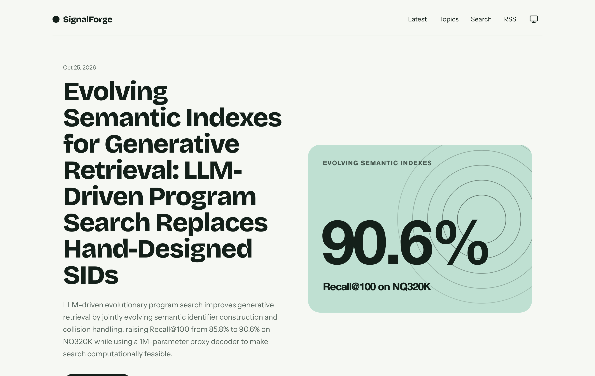
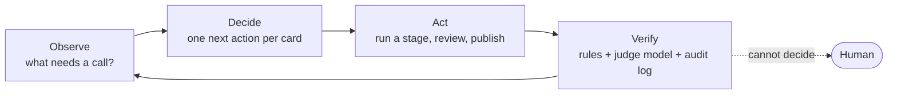
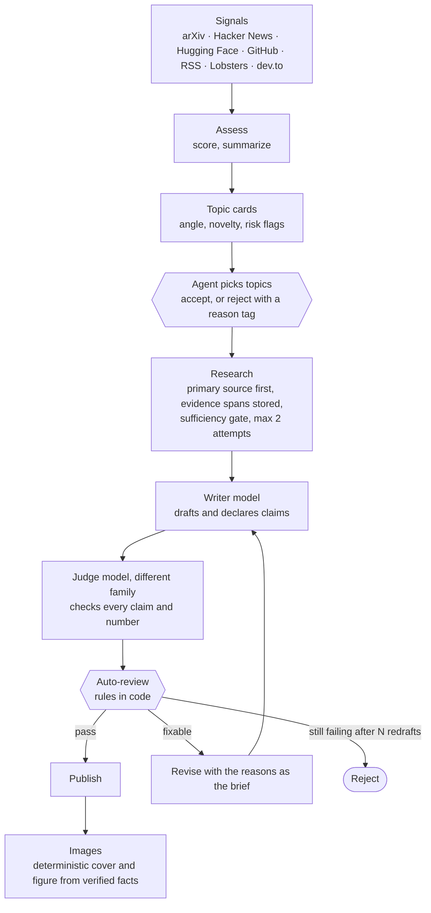
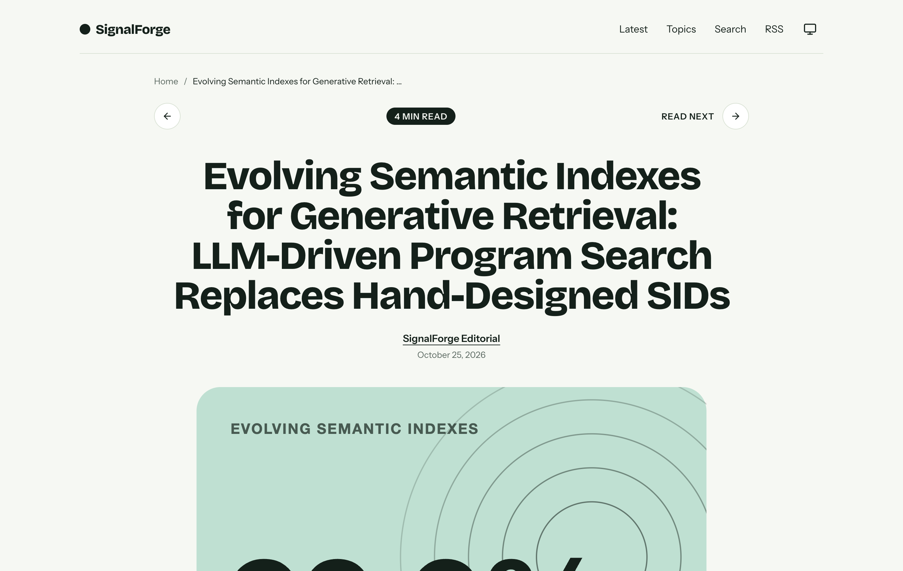

# SignalForge

**An autonomous AI-engineering newsroom, run by an agent.**

SignalForge watches the AI world for emerging signals, researches the ones that matter, and publishes articles in which every claim is traced to a stored source and checked by a second model. A tool-using agent, **Hermes**, can operate the whole thing end to end: pick topics, trigger research and drafting, review, publish and illustrate, with a human able to step in at any point.

> The article is the output. The agent system behind it is the product.

## The question behind it

Anyone can make an LLM write an article. The interesting problem is agent engineering:

**How do you give an agent real, multi-step, partly autonomous work, and still be able to trust what comes out?**

SignalForge is my answer, built and iterated over 110+ pull requests. The short version: you do not get trust from a better prompt. You get it from **structure around the model**: typed hand-offs, evidence the model cannot skip, a second model that cannot be the first, rules in code where judgement is cheap to get wrong, and a system that always tells the agent exactly what to do next.

## The agent loop

Hermes does not improvise a plan. It runs a tight **observe, decide, act, verify** loop against a system that exposes its own state.

- **Observe.** The system reports, for every card, a stage and a single `next_action`. The agent never has to infer state from logs or remember where it was. The mapping from stored statuses to the next action is one pure function, easy to test and impossible for the model to misread.
- **Decide.** The set of actions is small and closed: research, retry, draft, review, revise, publish, attach images, wait, or hand to a human. A closed action space is what makes an agent reliable.
- **Act.** Each action is idempotent and runs in the background. One run at a time, so an eager agent cannot stampede the pipeline or the budget.
- **Verify.** Nothing the agent does is trusted on its own say-so. Output passes mechanical checks, then an independent judge model, then deterministic review rules.
- **Escalate.** When the right move is judgement, such as a draft with no usable claims, the agent routes it to a human instead of forcing it through.

### One article's journey

## Agentic engineering, in practice

### 1. Separate the writer from the grader
The writer and the claim judge are different roles, and the system **warns when they share a model family** (only NVIDIA-hosted models were reachable, so a cross-family judge was not possible). A model should not mark its own homework. Milestone 2 makes this a hard check again once a cross-family judge passes calibration.

### 2. Evidence before prose
Research stores source documents and exact evidence spans first. The writer only sees that package, and every claim it declares must point at a span. A mechanical span match runs before the LLM judge, because a cheap deterministic check should always go first. Research has to earn its place too: it needs at least three claims (one extra search round if short), arXiv papers are read by their results and limitations sections, and a card that fails research twice is closed with a reason instead of retried forever.

### 3. Flag, do not block
My first design failed closed: any unsupported sentence killed the whole draft. I built an evaluation harness with a golden set and measured it. Across the same four fixtures:

| Contract | Drafts that survived | Grounded-sentence rate |
| --- | --- | --- |
| Block on any unsupported sentence | 0 of 4 | 56% |
| **Flag the sentence, keep the draft** | **4 of 4** | **88%** |

Flagged sentences are then deleted by the review rules rather than shipped. The judge is not perfect either, so I measured it too: on deliberately corrupted sentences it wrongly accepted 20%, and **0%** when a number had been changed, because numbers are checked mechanically rather than by the model. That is the point of the design: **put each check where it is strongest.**

### 4. Judgement as code
Automatic review is the editor's read-through written as pure, testable functions with no model and no database:

- Too many flagged sentences, too short, or too few verified claims: **revise**, and the reasons become the brief for the next draft.
- Otherwise flagged sentences are deleted, a flagged headline summary is replaced, and a section left empty is removed.
- After a fixed number of failed redrafts: **reject**. The loop is bounded by design.

### 5. Budgets, cost and an audit trail
Every LLM call is logged with its cost, per-card budgets are checked before each call, and every edit or decision is recorded with an `actor`: the agent or a human. You can replay exactly what the agent did and why.

### 6. Roles, not model names
Stages ask for a *role* such as writer, judge or relevance filter. The role map is the only place a model is named. I have run this system on several different model families by changing configuration alone, and the evaluation harness tells me what each swap does to quality.

### 7. Untrusted text stays data
Everything the agent reads from the web is wrapped, escaped, and declared as data in the system prompt. Fetching checks URL safety and robots rules. A scraped page cannot give the agent instructions.

### 8. Least privilege for the agent
Hermes holds one **revocable** key. It has no database access and no storage credentials: even image upload goes through the application, which holds the storage key itself. Revoking the key stops the agent immediately.

### 9. Skills, not scripts
Capabilities the agent needs are packaged as skills. The `article-images` skill is the example. No model draws: a script builds a cover ("Signal Steps", one of 13 soft pastels, with a headline fact grounded in the article's verified claims) and a figure, rejects any number not in the article, renders deterministic SVG, and uploads it. The autopilot runs it every 15 minutes. The model supplies judgement, and code supplies the guarantees.

## How the autonomy grew

The project moved from "AI assists a human" to "a human supervises an agent", one safe step at a time.

| Stage | What changed |
| --- | --- |
| Human in every step | Editor triages cards, reads every draft, publishes by hand |
| Chained pipeline | Accepting a card triggers research and drafting automatically |
| Reviewer in code | Auto-review replaces the read-through with rules and bounded redrafts |
| Agent operated | Hermes runs the whole loop through a dedicated, revocable interface |
| Least privilege | Image upload moved behind the application, so the agent needs no storage key |

Each step shipped only after the previous one was measured, and I kept the human override at every level.

## What broke, and what I did about it

I audited my own pipeline and wrote up the failures: invisible failures with no reason recorded, no retry path, a soft budget cap, writer and judge each fed far more source text than needed, and a claim heuristic that marked agreeing sources as conflicting. Each finding became a change: failure reasons and retries, per-card budgets, a state machine, an evaluation harness, a stricter judge prompt, and a prompt that is versioned and compared rather than judged by eye. Most of the engineering in this repo is a response to a measured failure.

## Example output

Every published article is built from its verified claims and carries its sources.

## Running it

A cloud cron job (the autopilot, `python -m apps.worker.autopilot`) runs every 15 minutes. It publishes the next queued draft, makes images, closes dead cards, and once per 6-hour slot (00, 06, 12, 18) accepts the two top-scored cards and takes them through research, draft, review and publish. A slot lease stops two runners from doubling a slot. The owner can pause everything with a kill switch, and the autopilot sends a webhook alert after repeated failures. Publishing is paced by the API: at least 4 hours apart, at most 3 per day. Hermes is the owner's Telegram control (status, pause, resume, publish now, hot topics) and sends an evening report; it does not drive the pipeline. Cron setup is in [docs/deploy-cron.md](docs/deploy-cron.md); Hermes setup, and the laptop launchd fallback, in [docs/hermes-setup.md](docs/hermes-setup.md).

## Architecture

The full picture, with diagrams and the research and publishing details, is in [ARCHITECTURE.md](ARCHITECTURE.md). In short: a modular monolith in one repository, designed so the agent layer sits on top of boring, testable parts.

- **Core** defines protocols only (sources, search, LLM gateway, ranker, publisher, stage) plus budgets, retries and typed errors. It imports nothing from stages or plugins.
- **Plugins** implement those protocols and are chosen by configuration: sources, search providers, rankers.
- **LLM gateway** resolves roles to models, caps output, records cost and failures.
- **Stages** each take a typed artifact and return a typed artifact. State lives in Postgres, never in a model's context.
- **API and workers** expose the pipeline to humans and to the agent. **Web** is a Next.js site that never touches the database.

## Stack

Python, FastAPI, SQLAlchemy, Alembic, Postgres with pgvector (Supabase), any OpenAI-compatible LLM API, Tavily, Next.js, Tailwind. Backend on Render, site on Vercel.
