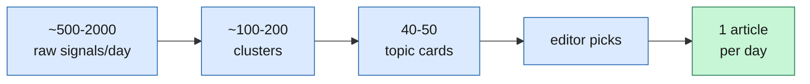

# SignalForge Architecture Diagrams

Visual view of the V1 architecture. **Diagrams only — this file makes no decisions.**
[`signalforge_prd.md`](signalforge_prd.md) stays the source of truth; if the two disagree, the PRD wins and this file is the bug.

Source sections: §20 architecture decision, §21 system shape, §22 pipeline, §24 plug-in contracts, §27-28 data and state, §35 state machine, §37 stage details, §38 frontend/API boundary.

---

## 1. System Architecture

Container view. The three things this diagram exists to make obvious: Next.js never reaches the database, stages depend on protocols rather than providers, and every external service enters through a plugin.

```mermaid
flowchart TB
    EDITOR(["Editor<br/>30-40 min per night"])
    READER(["Readers · Search engines · AI agents"])

    subgraph APP["SignalForge — modular monolith, one repo"]
        direction TB

        subgraph FE["Next.js · TypeScript strict"]
            DASH["Editor Dashboard<br/>triage · draft review · costs · failures"]
            SITE["Public Site<br/>ISR · RSS · sitemap · JSON-LD"]
        end

        subgraph BE["FastAPI"]
            EAPI["/editor/* · authenticated"]
            PAPI["/public/* · read-only, cacheable"]
            HOOK["/hooks/* · revalidate, webhooks"]
        end

        REPOS["Repositories · SQLAlchemy"]

        subgraph WK["Python Worker"]
            PIPE["Pipeline engine<br/>sole owner of business state"]
            STAGES["Stages 1-10<br/>typed artifact in → typed artifact out"]
            PIPE --> STAGES
        end

        subgraph CORE["core/ · protocols only, zero provider knowledge"]
            PROTO["Source · SearchProvider · LLMGateway<br/>Ranker · Publisher · Stage"]
            GUARD["budgets · idempotency · provenance · typed errors"]
        end

        subgraph PLUG["plugins/ · selected by config, replaceable"]
            PSRC["sources<br/>github · hn · rss · arxiv · hf"]
            PSEA["search<br/>direct_fetch · tavily · firecrawl"]
            PLLM["llm gateway<br/>roles · routing · fallback · cost log"]
            PRNK["rankers<br/>rules · embeddings"]
            PPUB["publishers<br/>owned site"]
        end
    end

    subgraph DATA["PostgreSQL · system of record"]
        TBL[("JSONB artifacts + pgvector<br/>discovery · editorial · research<br/>content · ops · metrics")]
        JOBQ[["Job queue + scheduler<br/>FOR UPDATE SKIP LOCKED"]]
    end

    subgraph EXT["External world"]
        XFEED["Source APIs and feeds"]
        XWEB["Web pages"]
        XLLM["LLM providers<br/>OpenAI-compatible"]
    end

    EDITOR <--> DASH
    READER --> SITE

    DASH -->|HTTPS| EAPI
    SITE -->|HTTPS only path to data| PAPI
    PPUB -->|revalidate| HOOK

    EAPI --> REPOS
    PAPI --> REPOS
    HOOK --> REPOS
    REPOS --> TBL

    JOBQ ==>|lease| PIPE
    PIPE <--> TBL
    PIPE --> JOBQ

    STAGES -.->|depends on| PROTO
    STAGES -.-> GUARD
    PSRC -.->|implements| PROTO
    PSEA -.->|implements| PROTO
    PLLM -.->|implements| PROTO
    PRNK -.->|implements| PROTO
    PPUB -.->|implements| PROTO

    PSRC --> XFEED
    PSEA --> XWEB
    PLLM --> XLLM

    classDef human fill:#fde8c8,stroke:#b7791f,color:#1a1a1a
    classDef app fill:#fed7e2,stroke:#b83280,color:#1a1a1a
    classDef work fill:#dbeafe,stroke:#2b6cb0,color:#1a1a1a
    classDef core fill:#fefcbf,stroke:#b7791f,color:#1a1a1a
    classDef plugin fill:#e9d8fd,stroke:#6b46c1,color:#1a1a1a
    classDef data fill:#c6f6d5,stroke:#2f855a,color:#1a1a1a
    classDef ext fill:#edf2f7,stroke:#4a5568,color:#1a1a1a
    classDef note fill:#fff5f5,stroke:#c53030,color:#1a1a1a

    class EDITOR,READER human
    class DASH,SITE,EAPI,PAPI,HOOK,REPOS app
    class PIPE,STAGES work
    class PROTO,GUARD core
    class PSRC,PSEA,PLLM,PRNK,PPUB plugin
    class TBL,JOBQ data
    class XFEED,XWEB,XLLM ext
```

**Reading the arrows:** solid is runtime data flow, thick is job dispatch, dotted is a dependency or implementation relationship. The dotted arrows all point *into* `core/`, which is the dependency inversion: `core/` imports nothing from `stages/` or `plugins/`.

---

## 2. Operational Flow

The nightly path from raw signal to live article, with every decision point and every exit. Rectangles are work, diamonds are decisions, rounded boxes are terminal states.

```mermaid
flowchart TD
    CRON([Cron · every 30-60 min]) --> INGEST["Ingest sources<br/>normalize → RawSignal, canonical URL, hash"]

    INGEST --> DDUP{"Duplicate of a<br/>known cluster?"}
    DDUP -->|"yes · URL, hash or<br/>embedding + entity overlap"| MERGE["Merge into existing cluster"]
    DDUP -->|no| NEWC["Create new cluster"]
    MERGE --> RELV
    NEWC --> RELV

    RELV{"Relevant to<br/>AI engineering?"}
    RELV -->|"no · deterministic rules"| DROP(["Dropped"])
    RELV -->|"low confidence"| ESC["Escalate to<br/>stronger model"]
    ESC --> RELV
    RELV -->|yes| RANK["Rank clusters<br/>+ inject 10-20% wildcards"]

    RANK --> CARDS["Build 40-50 TopicCards<br/>light research, nightly"]
    CARDS --> GATE1{{"EDITOR REVIEW 1<br/>~20 sec per card"}}

    GATE1 -->|reject + reason tag| REJ(["Rejected<br/>logged as training label"])
    GATE1 -->|snooze| SNOOZE(["Snoozed backlog"])
    GATE1 -->|need more info| BRIEF["Deeper brief"]
    BRIEF --> GATE1
    SNOOZE -.->|resurfaced later| GATE1
    GATE1 -->|accept| RESEARCH

    RESEARCH["Deep research<br/>primary sources first<br/>store documents + evidence spans"]
    RESEARCH --> BUDG{"Within budget?<br/>~$0.50 per topic"}
    BUDG -->|no| FAIL
    BUDG -->|yes| PKG["ResearchPackage<br/>claims · sources · conflicts · gaps"]

    PKG --> WRITE["Write draft<br/>input is ResearchPackage only"]
    WRITE --> MECH{"Cited span exists in<br/>stored source text?"}
    MECH -->|"no · mechanical check fails"| FLAG["Mark unverified"]
    MECH -->|yes| JUDGE{"Judge confirms support?<br/>different model family"}
    JUDGE -->|no| FLAG
    JUDGE -->|yes| STATUS["Assign claim status<br/>verified · supported · uncertain<br/>conflicting · unverified"]
    FLAG --> STATUS

    STATUS --> CORE{"All core claims<br/>verified or supported?"}
    CORE -->|no| REVISE["Remove, hedge,<br/>or escalate to editor"]
    REVISE --> SEO
    CORE -->|yes| SEO

    SEO["SEO and structuring<br/>slug · metadata · JSON-LD · internal links"]
    SEO --> RECHK{"SEO changed a title,<br/>description or heading?"}
    RECHK -->|yes| RECLAIM["Re-run claim check"]
    RECLAIM --> SUMMARY
    RECHK -->|no| SUMMARY

    SUMMARY["Build review summary<br/>risks · single-source · disagreements"]
    SUMMARY --> GATE2{{"EDITOR REVIEW 2<br/>~10 min, risk-summary first"}}

    GATE2 -->|reject| REJ2(["Rejected"])
    GATE2 -->|"revise + notes"| WRITE
    GATE2 -->|approve| BAR

    BAR{"Meets the<br/>quality bar?"}
    BAR -->|"no · skip rule"| SKIP(["Slot skipped<br/>quality over quota"])
    BAR -->|yes| SCHED["Schedule for<br/>audience time zone"]

    SCHED --> PUB["Publish<br/>idempotent on article + version"]
    PUB --> LIVE{"Live page<br/>verifies?"}
    LIVE -->|no| FAIL
    LIVE -->|yes| DONE(["Published<br/>live_verified → monitoring"])

    DONE --> ANALYTICS["Analytics · referrers ·<br/>crawler hits · citation probes"]
    ANALYTICS -.->|labeled feedback| RANK

    FAIL(["FAILED<br/>visible reason on dashboard<br/>never a silent skip"])

    classDef work fill:#dbeafe,stroke:#2b6cb0,color:#1a1a1a
    classDef decision fill:#fefcbf,stroke:#b7791f,color:#1a1a1a
    classDef gate fill:#fde8c8,stroke:#b7791f,color:#1a1a1a,font-weight:bold
    classDef good fill:#c6f6d5,stroke:#2f855a,color:#1a1a1a
    classDef bad fill:#fed7d7,stroke:#c53030,color:#1a1a1a
    classDef neutral fill:#edf2f7,stroke:#4a5568,color:#1a1a1a

    class INGEST,MERGE,NEWC,ESC,RANK,CARDS,BRIEF,RESEARCH,PKG,WRITE,STATUS,FLAG,REVISE,SEO,RECLAIM,SUMMARY,SCHED,PUB,ANALYTICS work
    class DDUP,RELV,BUDG,MECH,JUDGE,CORE,RECHK,BAR,LIVE decision
    class GATE1,GATE2 gate
    class DONE good
    class FAIL,REJ,REJ2 bad
    class DROP,SNOOZE,SKIP,CRON neutral
```

**Three properties worth tracing on this diagram.** Every rejection path ends in a recorded state, never a silent drop, and the reason is stored as a labeled decision that feeds ranking. Both human gates can send work backwards (`need more info` → card rebuild, `revise` → redraft) rather than only forward or out. And SEO sits before review 2, so the editor approves the exact artifact that ships.

---

## 3. Funnel Volumes

Where the narrowing happens, per PRD §8.

Wide ingest, narrow publication. The cost control is that expensive stages only run after the editor gate: deep research and drafting never touch a topic nobody selected.
