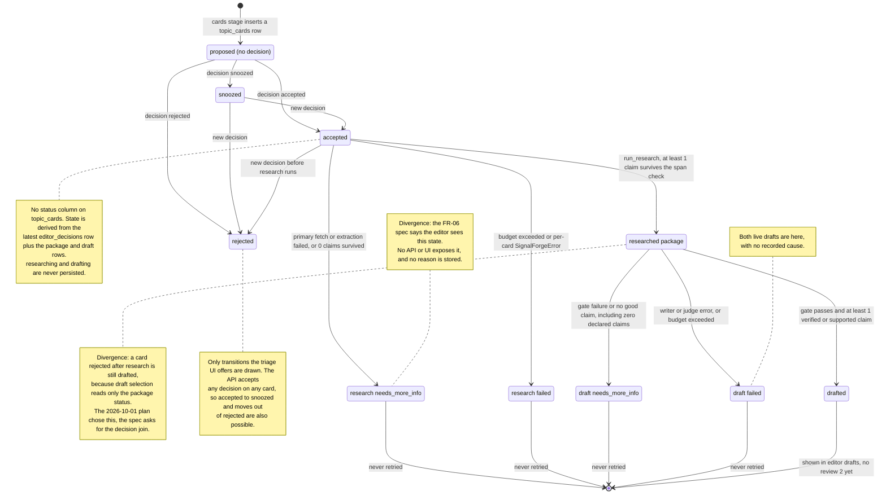
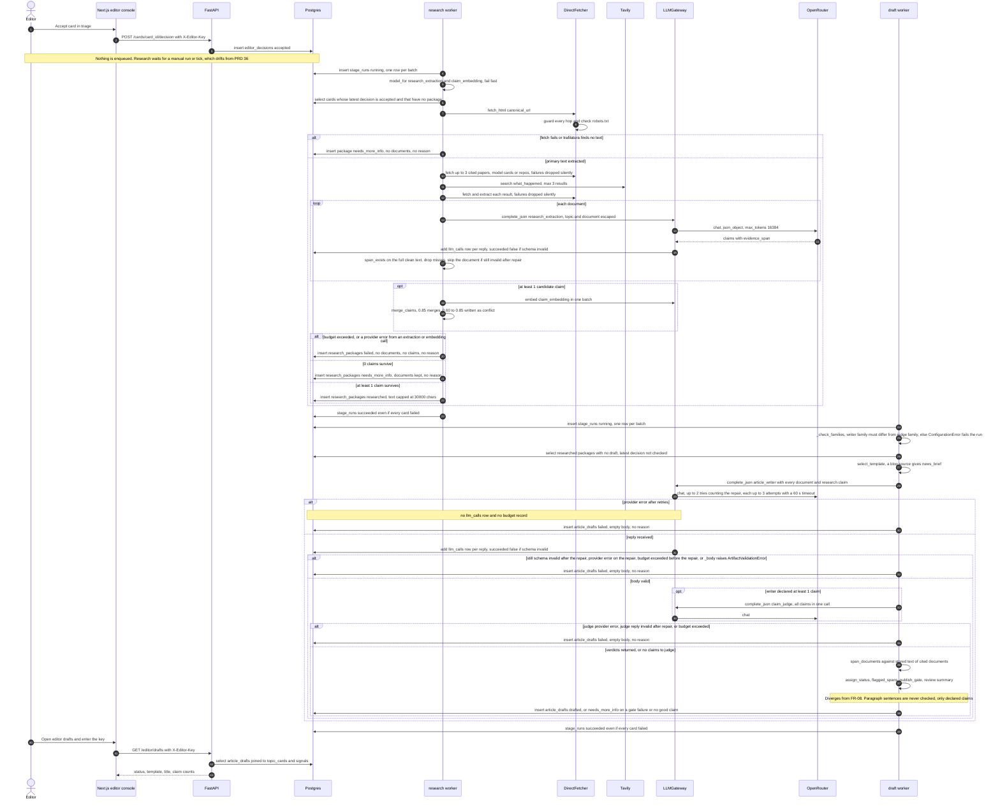

# Selection to draft: pipeline debug report

Checked on 2026-10-17 (database clock) against `main` at `798e901` (#86) and the shared Supabase dev database. Scope: from an editor accepting a topic card, through research, to a verified draft visible in `/editor/drafts`. No source code was changed. Proposed fixes are listed here only.

## 1. Summary

Selection and research work mechanically. Both accepted cards were researched for about $0.0045 each, with 13 span-checked claims and 4 to 5 stored documents per card. Drafting does not work in practice: both cards have a `failed` draft with no body, and nothing in the database, API or UI says why. The current default writer (`anthropic/claude-fable-5.1`) has no successful call on record, and no recorded call shows it was ever tried. Failed and `needs_more_info` rows are never reselected, and the evidence shows reruns have been done by deleting rows by hand.

Top issues:

1. Failures are invisible (F1, F9). There is no reason column, failed provider attempts write no `llm_calls` row, and every research and draft `stage_runs` row says `succeeded`.
2. The writer step fails before a body is stored (F2, F3, F4). One reply was cut off at the global 16,384 output-token cap. In the same run b84beb7f got a schema-valid repair reply and still ended `failed` with no judge row. f5b9e7e5 also got a schema-valid repair reply in that run, but its row is gone, so its outcome then (`failed`, or `needs_more_info` if the writer declared zero claims) is unknown. The latest run spent 183 s with zero recorded calls.
3. There is no retry path (F5). One transient error parks a card forever.
4. Claim status is unreliable even when drafting succeeds. The disagreement heuristic marks agreeing headline claims `conflicting` (F6), and paragraph text is never verified, only the claims the writer chooses to declare (F7).
5. The budget is a soft cap (F8), and the writer and judge each receive 20k to 35k tokens of source text for a 250 to 400 word brief (F16).

## 2. Environment checked

| Item | Result |
| --- | --- |
| Review file | Absent in the first iteration. Present in the second (`review.json`, 8 findings), and every finding is addressed in this revision |
| Repo | `main` at `798e901`, clean except the untracked `docs/superpowers/specs/2026-10-01-article-drafting-research.md` (read, not modified) |
| DB reachable | Yes: `triage_metrics --days 30` returned `cards_created=44 decided=2 accept_rate=1.00 waiting=42` |
| Migrations | `alembic current` = `0007 (head)`, `alembic heads` = `0007 (head)`. No upgrade needed or run |
| Settings (non-secret) | `LLM_PROVIDER=openai_compatible`, base URL host `openrouter.ai`, `LLM_MAX_OUTPUT_TOKENS=16384`, budgets TOPIC $0.50 and ARTICLE $1.50. `LLM_API_KEY`/`OPENROUTER_API_KEY`, `TAVILY_API_KEY` and `EDITOR_API_KEY` are set (values not read out). No `LLM_MODEL_*` override except `LLM_MODEL_RELEVANCE` |
| Role routing | research_extraction `openai/gpt-4o-mini`, claim_embedding `openai/text-embedding-3-small`, article_writer `anthropic/claude-fable-5.1` (family anthropic), claim_judge `google/gemini-2.5-flash-lite` (family google) |
| Unit tests | `uv run pytest -q`: 491 passed, 70 skipped, in both iterations |
| Integration tests | Skipped: `TEST_DATABASE_URL` is not set in the shell or `.env` |
| Scheduling | `crontab -l`: "no crontab for suraj". Nothing runs the pipeline automatically on this machine |
| Mermaid validation | `mmdc` not installed (not on PATH, not in the npx cache). Diagrams were checked by hand only |
| Total spend | $0.00 across both iterations. `llm_calls` was 220 rows / $0.052490 before the first iteration and after the second. 0 `llm_calls` rows created on 2026-10-17. 0 Tavily calls (research considered 0 cards). The second iteration ran no stage CLI |

Commands run, in order (all from the repo root):

1. `ls .agents/tasks/pipeline-debug/`, `git status --short`, `git log`
2. `uv run python -m apps.worker.triage_metrics --days 30`
3. `uv run alembic current`, `uv run alembic heads`
4. `uv run python -c ...` printing non-secret settings and `build_roles()` model ids and families
5. `uv run pytest -q`
6. Read-only SQL through `uv run python - <<EOF` using `create_db_engine(get_settings(), ConnectionMode.SESSION)` and `SET TRANSACTION READ ONLY` (queries below)
7. Offline package analysis (A1): load both `research_packages` rows read-only, rebuild them with `draft._package`, recompute `sha256(text)` against `raw_text_ref`, re-run `span_exists` for every cited document, `flagged_spans`, `_template_for`, and measure `_writer_user` and `_documents_block` sizes
8. In-process API reads (A2, A3): `TestClient(create_app())` with `GET /editor/drafts`, `GET /editor/drafts/{card_id}` (key from settings, not printed) and `GET /cards/queue?limit=50&days=30`
9. In-memory reproductions R1 to R10 (FakeProvider or stub providers, a stub session, no network, no DB writes), described below
10. `curl https://openrouter.ai/api/v1/models` (public, unauthenticated, nothing from the project sent) to check that the configured model ids exist and their prices
11. `uv run python -m apps.worker.research --limit 1` printed `considered=0 researched=0 needs_more_info=0 failed=0`
12. `uv run python -m apps.worker.draft --limit 1` printed `considered=0 drafted=0 needs_more_info=0 failed=0`
13. Read-only SQL re-check of spend and `stage_runs` key shape. `crontab -l`, `which mmdc`

Steps 11 and 12 each wrote one `stage_runs` row (research 07:56:50 UTC, draft 07:56:59 UTC, both `succeeded`). Nothing else was written.

Second iteration (review fixes), all read-only:

14. `ls .agents/tasks/pipeline-debug/`, `git status --short`, `git log -15` (PR dates for #81 to #86)
15. Read-only SQL (same engine, `SET TRANSACTION READ ONLY`): spend total and rows dated today, `topic_card` cost by `succeeded`, every `succeeded = false` row, the 2026-10-08 draft runs with their `started_at`, `finished_at` and per-call latency, `article_drafts` timestamps, accepted card ages, `claim_judge` call times, and a sentence split of 5373b071's `gaps_and_disagreements`
16. Code re-reads: `stages/draft.py` (`_WriterReply`, `_body`, `_judge`, `_process_card`, `_check_families`, `run_draft`), `stages/research.py` (`_process_card` outcomes), `llm/gateway.py` (`complete_json`, `_record`), `llm/providers.py` (where `latency_ms` is measured), `core/budget.py`, `core/config.py:budget_limits`, `db/repositories/article.py:list_researched_undrafted`, `apps/web/src/app/api/cards/[id]/decision/route.ts`, and the 2026-10-01 drafting spec and plan
17. `uv run pytest -q`

```sql
-- F3 timing: run length against writer latency, and which rows belong to which card
select started_at, finished_at, extract(epoch from finished_at - started_at)
  from stage_runs where stage = 'draft' and started_at::date = date '2026-10-08';
select l.created_at, l.role, l.model, l.succeeded, l.input_tokens, l.output_tokens, l.latency_ms, l.error
  from stage_runs s join llm_calls l on l.stage_run_id = s.id
  where s.stage = 'draft' and s.started_at::date = date '2026-10-08' order by l.created_at;
select card_id, status, created_at, calls, tokens from article_drafts;
-- rows written for replies that failed the schema
select role, model, error, count(*) from llm_calls where not succeeded group by 1,2,3;
```

Key SQL (copy-paste to re-check):

```sql
-- latest decision per card
select d.decision, count(*) from (select distinct on (topic_card_id) topic_card_id, decision
  from editor_decisions order by topic_card_id, decided_at desc, created_at desc) d group by 1;
-- packages and drafts
select id, card_id, status, schema_version, jsonb_array_length(documents), jsonb_array_length(claims),
  length(gaps_and_disagreements), cost_usd, calls, tokens from research_packages;
select card_id, status, template, draft = '{}'::jsonb as empty_body, length(review_summary), cost_usd, calls, tokens
  from article_drafts;
-- stage runs and their calls
select stage, status, started_at, finished_at, error from stage_runs where stage in ('research','draft') order by started_at;
select s.stage, s.started_at, l.role, l.model, l.succeeded, l.input_tokens, l.output_tokens, l.cost_usd, l.latency_ms, l.error
  from stage_runs s join llm_calls l on l.stage_run_id = s.id where s.stage in ('research','draft') order by s.started_at, l.created_at;
-- idempotency key shape
select stage, count(*), count(distinct entity_id), count(distinct input_hash), count(distinct stage_config_hash),
  bool_and(input_artifact_id is null), bool_and(output_artifact_id is null), sum(retry_count)
  from stage_runs where stage in ('research','draft') group by 1;
-- spend by role
select role, model, succeeded, count(*), sum(input_tokens), sum(output_tokens), sum(cost_usd), avg(latency_ms), max(latency_ms)
  from llm_calls group by 1,2,3;
```

In-memory reproductions:

| ID | What it does | Result |
| --- | --- | --- |
| R1 | `draft._process_card` with a provider that raises `OperationTimeoutError`, backoff sleep captured | Raises `OperationTimeoutError`. 0 `LLMCall` rows staged, `budget.calls == 0`, sleeps `[0.5, 1.0]`, worst case 3 x 60 s + 1.5 s = 181.5 s |
| R2 | Every stored research claim reused as a writer claim, judge says supported for all, `assign_status` | 3f151dcd: 1 conflicting, 8 verified, 4 supported. 5373b071: 7 conflicting, 1 verified, 5 supported. The first (headline) claim is `conflicting` in both |
| R3 | FakeProvider writer reply: one real primary claim plus a paragraph sentence invented for the test ("available for five dollars per month and beats every closed model on every benchmark"), judge supports | `drafted`, 283 words, claim `verified`, review summary does not mention the invented sentence |
| R4 | `Budget(ARTICLE, 1.50)`: check, record 1.17, check, record 1.17 | Both checks pass, spent 2.34 against a 1.50 limit |
| R5 | `ResearchPackage.model_validate` on a document without `text` | `pydantic.ValidationError`, not a `SignalForgeError` |
| R6 | `inspect.getsource` of both selection queries | `list_researched_undrafted` does not reference `EditorDecisionRow`. `list_accepted_unresearched` has no package-status filter |
| R7 | `_rank("https://huggingface.co/inference/models")` | Ranked as a model repo (rank 2) |
| R8 | `select_template(source_type="blog", card_format="deep_dive", ...)` | `news_brief` |
| R9 | `research._process_card` with a fetcher where the cited arXiv link and the Tavily result both fail | `researched` with only the primary document, `gaps_and_disagreements` empty, no record of the 3 dropped URLs |
| R10 | `build_search` with no `TAVILY_API_KEY` | Returns `NoSecondarySearch` |

## 3. Current data snapshot

Cards and decisions:

| Metric | Value |
| --- | --- |
| `topic_cards` | 44 (all `card-v1`) |
| Latest decision accepted / rejected / snoozed | 2 / 0 / 0 |
| No decision | 42 |
| Accepted with no package | 0 |
| Researched with no draft | 0 |
| Drafted cards still in the triage queue (A3) | 0 of 2 (queue holds 42) |

The two accepted cards are both RSS blog posts with card format `deep_dive`:

| Card | Signal | Package | Draft |
| --- | --- | --- | --- |
| `f5b9e7e5` | "One Model Family, Two Gold-Level Results: Fine-Tuning Nemotron for IOI and IMO" (huggingface.co blog) | `3f151dcd`, researched, 5 docs, 13 claims, gaps 125 chars, $0.005282, 6 calls, 32,090 tokens | failed, news_brief, empty body, review_summary empty, $0, 0 calls, 0 tokens, created 2026-10-08 17:04 UTC |
| `b84beb7f` | "EmbeddingGemma 2: an open, lightweight multimodal embedding model" (deepmind.google blog) | `5373b071`, researched, 4 docs, 13 claims, gaps 4,665 chars, $0.003710, 5 calls, 20,543 tokens | failed, news_brief, empty body, review_summary empty, $0, 2 calls, 70,160 tokens, created 2026-10-08 14:39 UTC |

Package detail (A1): all 26 package claims are `unverified`, which matches the FR-06 design (status is assigned on draft claims). 3 of 9 stored documents are cut at exactly 30,000 chars, and those 3 have a `raw_text_ref` that does not match the stored text. 5373b071 has 3 merged multi-document claims, and in 3 (claim, document) pairs the quote is not in the cited document. Primary documents carry `source_label = "rss"`.

What the editor sees (A2): `GET /editor/drafts` returns both rows with `status: failed`, `title: ""`, `claim_counts: {}`. The detail view returns `draft: null, review_summary: ""`, so `ArticlePreview` renders "Drafting failed." with no cause.

Stage runs (research and draft only, including the 2 from this check):

| Stage | Runs | Status | `error` | Runs with no `llm_calls` |
| --- | --- | --- | --- | --- |
| research | 6 | all succeeded | all NULL | 3 |
| draft | 12 | all succeeded | all NULL | 6 |

Draft runs that matter:

| Run start (UTC) | Length | Calls recorded | Outcome |
| --- | --- | --- | --- |
| 2026-10-08 14:28:59 | 625.6 s | 4 article_writer (nemotron free), 0 claim_judge | b84beb7f ended `failed`. Its row survives, and its tokens (70,160) equal its two writer calls exactly. f5b9e7e5 got a schema-valid repair reply first, but its row from this run is gone, so its outcome is unknown (`failed`, or `needs_more_info` if the writer declared zero claims) |
| 2026-10-08 17:00:41 | 16 s | 0 | No surviving row |
| 2026-10-08 17:04:14 | 182.9 s | 0 | f5b9e7e5 failed with calls=0 |

In the 14:28 run the four writer calls took 178.8 s (2 validation errors) and 74.9 s (ok) for f5b9e7e5, then 211.6 s (1 validation error) and 151.8 s (ok) for b84beb7f. That is 617.1 s of the run's 625.6 s, which leaves 8.5 s for everything else in both cards. Cards are taken oldest first and f5b9e7e5 is the older card, so the first pair is its own. The second pair shares `created_at` (14:39:25.198, the transaction start) with b84beb7f's draft row.

`llm_calls` across all stages (220 calls, $0.052490 total):

| Role | Model | OK / failed | Input tok | Output tok | Cost | Avg / max latency |
| --- | --- | --- | --- | --- | --- | --- |
| article_writer | openai/gpt-4o-mini | 10 / 0 | 68,531 | 9,332 | $0.0159 | 11.9 s / 19.2 s |
| article_writer | nvidia/nemotron-3-super-120b-a12b:free | 2 / 2 (validation) | 113,699 | 50,536 | $0 | 113 s ok, 195 s failed / 211.6 s |
| claim_judge | google/gemini-2.5-flash-lite | 6 / 0 | 66,188 | 548 | $0.0068 | 1.6 s / 2.3 s |
| research_extraction | openai/gpt-4o-mini | 17 / 0 | 59,232 | 4,878 | $0.0118 | 4.9 s / 9.1 s |
| claim_embedding | openai/text-embedding-3-small | 6 / 0 | 1,630 | 0 | $0 (see F20) | 1.7 s / 2.3 s |
| relevance_filter | openai/gpt-4o-mini | 131 / 0 | 27,122 | 10,734 | $0.0105 | 2.2 s |
| topic_card | openai/gpt-4o-mini | 44 / 2 (validation) | 14,473 | 8,787 | $0.0074 | 3.3 s |

No `anthropic/claude-fable-5.1` call has ever been recorded. The gpt-4o-mini writer runs on 2026-10-07 produced drafts that no longer exist. No code path deletes `research_packages` or `article_drafts` rows (grep for delete calls finds only FK `ondelete` clauses), so those rows were removed outside the application.

## 4. Pipeline walkthrough

Business state has no column. It is derived from the latest `editor_decisions` row, then the `research_packages` row, then the `article_drafts` row. `researching` and `drafting` are artifact defaults but are never written, because rows are inserted only when a card finishes.

### N1. Triage queue (read)

- Code: `apps/web/src/app/editor/triage/page.tsx` (server) calls `lib/api.ts:fetchQueue`, then `GET /cards/queue` (`apps/api/routes/cards.py:card_queue`, open read, no key), then `CardRepository.queue`.
- Inputs: limit 15, 7 days, prompt version `card-v1`. Output: cards whose latest decision is none or `snoozed`, ranked, plus 2 wildcards.
- Tables: `topic_cards`, `editor_decisions`, `signals`. No LLM.
- Note: accepted cards leave the queue, so the triage `DraftPanel` never finds a draft for them (F26).

### N2. Editor decision (selection)

- Code: `TriageBoard`/`DecisionBar` call `lib/api.ts:postDecision` in the browser with `X-Editor-Key` held in memory. The Next proxy `app/api/cards/[id]/decision/route.ts:POST` checks the UUID, caps the body at 16 KB and times out after 10 s. FastAPI `cards.py:add_decision` runs `require_editor_key` (constant-time compare, 503 if unset), then `decision_body` (415 or 422), then `CardRepository.add_decision`.
- Inputs: `decision` in accepted, rejected or snoozed, reason tags, note, `decision_ms`. Output: one `editor_decisions` row with a Python-side `decided_at`.
- State: proposed or snoozed to accepted (derived). Errors from FastAPI, all in the one `{"error": {code, message, correlation_id}}` shape: 401 (bad key), 404 (unknown card), 415, 422, 503 (`EDITOR_API_KEY` unset, or a `RetryableError`) and 500 (any other `SignalForgeError`). Errors from the Next proxy: 400 (id is not a UUID), 413 (body over 16 KB), 503 (`API_BASE_URL` unset) and 502 (upstream unreachable or timed out).
- Nothing is enqueued. Research waits for the next manual run or `tick`.

### N3. Research run setup

- Code: `apps/worker/research.py:run` builds `DirectFetcher(httpx.Client())`, `build_search` (`TavilyClient`, or `NoSecondarySearch` with a warning when the key is unset) and `budget_limits(TOPIC)`. Then `stages/research.py:run_research`.
- Inserts one `stage_runs` row per batch (`entity_id = uuid5(namespace, "research")`, `input_hash` includes the start time, `stage_config_hash = sha256("research-v1")`).
- Fail fast: `model_for("research_extraction")` and `model_for("claim_embedding")`.
- Selection: `ResearchRepository.list_accepted_unresearched(limit)`: latest decision `accepted` and no package of any status, oldest card first. No row lock.

### N4. Primary fetch and extraction

- Code: `research._process_card` step 3, `DirectFetcher.fetch_html(signal.canonical_url)`, `research_extraction.extract_clean_text`.
- DirectFetcher, on every hop: scheme must be http or https. `localhost`, `.local`, `.internal` and any non-global resolved IP are refused. robots.txt is checked per origin (a 4xx robots file allows everything, any other failure disallows everything). Up to 5 redirects followed by hand, 10 s timeout, 3 attempts on retryable errors, `Retry-After` capped at 30 s, 5 MB cap checked after download.
- trafilatura runs with `favor_precision=True` and comments excluded.
- Failure: any `SignalForgeError`, or no text, gives a `needs_more_info` package with no documents and no reason.

### N5. Cited references

- Code: `reference_links(html, canonical_url, limit=3)` scans every `href` in the raw HTML. Ranking: arXiv, OpenReview and HF papers first, then model cards, then HF model repos (with a skip list), then GitHub repos. `_fetch_reference` tries the arXiv HTML render, then the abstract page.
- Failures are skipped with no log and no record (R9). `add_secondary` drops a document whose text hash is already held.

### N6. Secondary search

- Code: `TavilyClient.search(card.what_happened, max_results=3)`, basic depth, 10 s timeout, bounded retry, then fetch and extract each result through DirectFetcher.
- A search error is logged as a warning. Fetch or extraction failures are skipped silently.

### N7. Per-document claim extraction and span check

- Code: `_extract_document_claims`. The user prompt wraps `<topic>` (what_happened, why_it_matters) and `<document>` (first 30,000 chars), both `html.escape`d. The system prompt marks both as untrusted data.
- LLM: `gateway.complete_json(role="research_extraction", schema=_ExtractionReply)` with one repair retry, JSON mode and max_tokens 16,384. `_record` writes one `llm_calls` row per reply received: `succeeded = true` when it validates, `succeeded = false` with "N validation errors" when it does not (4 such rows exist today). A provider exception (timeout, 4xx, 5xx, malformed reply) writes no row (F9).
- Span check: `span_exists(unescape(span), clean_text)` against the full uncapped text. Misses are dropped. Survivors become `ResearchClaim(status=unverified)`.
- Failure: `BudgetExceededError` gives a `failed` package. `ArtifactValidationError` skips that document with a warning.

### N8. Claim merge and disagreement notes

- Code: one batched `gateway.embed(role="claim_embedding")`, then `merge_claims`. Cosine 0.85 or more merges the claims (document indices are unioned, the first claim's quote is kept). Cosine from 0.60 to 0.85 across different documents appends "Document i and Document j report conflicting claims near: '...'" to `gaps_and_disagreements`.
- Status: `researched` if at least one claim survives, otherwise `needs_more_info`.

### N9. Persist package

- Code: `ResearchRepository.insert` with `ON CONFLICT (card_id) DO NOTHING`, storing budget `spent_usd`, `calls` and `tokens`. Commit per card. `stage_runs` is set to `succeeded` at the end, or to `failed` plus re-raise on an unexpected exception.
- Stored: documents inline in JSONB (`text` capped at 30,000 chars, `raw_text_ref = sha256(full text)`), claims, and gaps text. Not stored: `produced_by`, `parent_ids` and a failure reason (there are no columns for them).

### N10. Draft run setup

- Code: `apps/worker/draft.py:run`, then `stages/draft.py:run_draft`. One `stage_runs` row per batch, same key shape as research (`draft-v2`).
- Fail fast: `_check_families` resolves both roles and raises `ConfigurationError` if `family_for(article_writer) == family_for(claim_judge)`. Family is the model id namespace (anthropic and google today). This check runs only here, not at API or worker startup.
- Selection: `ArticleDraftRepository.list_researched_undrafted(limit)`: package `researched` and no draft row. The latest decision is not checked. A new `Budget(ARTICLE, $1.50)` and gateway per card.

### N11. Template selection

- Code: `draft._template_for` calls `draft_extraction.select_template(source_type, card.format, signal.topics, signal.title)`. `paper` gives paper_breakdown. A comparison format or tag gives comparison. A `blog` source, a release tag or a release word in the title gives news_brief. Anything else gives explainer.
- Bands: news_brief 250 to 400 words, explainer 700 to 1000, paper_breakdown 500 to 800, comparison 600 to 900. Both live cards resolve to news_brief (R8).

### N12. Writer

- Code: `_package(row)` rebuilds the `ResearchPackage` (no `produced_by` or `parent_ids`). `_writer_user` sends the template, skeleton and length band, every document (escaped, up to 30,000 chars each) and every research claim with its quote. The writer never sees the card or the open web, so the FR-07 input rule holds.
- LLM: `complete_json(role="article_writer", schema=_WriterReply)`. Each attempt goes through `call_with_retry` (3 tries on retryable errors, 60 s httpx timeout per operation). One repair retry on invalid JSON. max_tokens 16,384.
- `_body` unescapes text, dedupes `document_indices` and builds `sources` from the stored documents, never from writer output. A `ValidationError` there (for example a field that is blank after unescape and strip) becomes `ArtifactValidationError`.
- `_WriterReply.claims` has no `min_length`, so a schema-valid reply may declare zero claims.

### N13. Mechanical span check and judge

- Code: `span_documents(claim, documents)` keeps only cited documents whose stored, capped text contains the quote. `_judge` makes one batched `complete_json(role="claim_judge")` call with every document and every claim's text. It returns `{}` without a call when the writer declared no claims. A missing verdict counts as not supported. In code order `_judge` runs first, then `span_documents` and `assign_status` per claim.

### N14. Status, publish gate, review summary

- `assign_status`: no span gives `unverified`. A quote overlapping a flagged research quote gives `conflicting`. Judge false gives `uncertain`. Primary document, or 2 or more distinct hosts, gives `verified`. Anything else gives `supported`.
- `publish_gate`: no em dash, no spaced en dash, no banned authorship phrases, word count inside the band. A draft also fails with "no claim reached verified or supported" when it has no good claim.
- Outcome: gate failures give `needs_more_info`, with the reasons in `review_summary`. Any `SignalForgeError` from the writer, the judge or the budget gives `failed` with no body and no reason.

### N15. Persist draft

- Code: `ArticleDraftRepository.insert` with `ON CONFLICT (card_id) DO NOTHING`. A failed card stores `{}`. Commit per card.

### N16. Editor reads drafts

- Code: `/editor/drafts` page, `DraftsBoard` (key in memory), Next proxies `app/api/editor/drafts/route.ts` and `[id]/route.ts`, then `articles.py:editor_drafts` and `editor_draft` (`require_editor_key`), then `list_recent` and `get`, then `ArticlePreview` (claims with status tags, source links through `safeHref`, review summary).
- No approve, revise or reject action exists yet (review 2 is a known gap).

## 5. Findings

| ID | Sev | Status | Node | Symptom | Root cause | Evidence | Proposed fix |
| --- | --- | --- | --- | --- | --- | --- | --- |
| F1 | high | CONFIRMED | N4, N9, N12 to N16 | Both drafts are `failed` with `{}` body and an empty review summary. Their runs say `succeeded` with `error` NULL. The editor sees "Drafting failed." with no cause. Research `needs_more_info` and `failed` rows have no cause either | The per-card `except SignalForgeError` branches build an empty artifact and only `log.warning` (draft does not even log `BudgetExceededError`). Neither table has a reason column, and the per-batch stage run hides per-card failures | A2 output (`draft: None, review_summary: ''`). SQL: 18 research and draft runs, all `succeeded`, all `error` NULL | Migration 0008 (expand only) adds `failure_reason text` to `research_packages` and `article_drafts`. Every failed and needs_more_info branch sets it from the error class and its fixed message. Show it in `DraftsBoard` and `ArticlePreview` |
| F2 | high | CONFIRMED | N12 | Writer reply for b84beb7f stopped at exactly 16,384 output tokens and failed validation | One global `LLM_MAX_OUTPUT_TOKENS` for every role. A reasoning model spends it on hidden reasoning, so the JSON is cut off, and the repair retry has the same cap | `llm_calls`, run 2026-10-08 14:28: (20,710 in, 16,384 out, "1 validation errors"), then (20,817 in, 12,249 out, ok). Draft row tokens 70,160 equal those two calls | Per-role output caps and reasoning limits in config. Read `finish_reason` in the provider and raise a distinct error on `length` instead of a repair retry that cannot fit |
| F3 | high | CONFIRMED symptom for b84beb7f, SUSPECTED cause | N12, N13 | In run 2026-10-08 14:28, b84beb7f got a schema-valid writer reply on the repair attempt and still ended `failed`, with no `claim_judge` row. f5b9e7e5 also got a schema-valid repair reply in that run, but its draft row from that run no longer exists and no log survives, so its outcome is unknown | For b84beb7f, either `_body()` raised `ArtifactValidationError` (for example a field blank after unescape and strip), or the judge call raised a fast provider error, which writes no row (F9). Ruled out: a judge timeout (only 8.5 s of the 625.6 s run was outside writer calls), a schema-invalid judge reply (it would have written a row), and budget (nemotron free cost $0 and only a cost cap is configured). For f5b9e7e5 the same two causes apply, plus a third: `_WriterReply.claims` has no `min_length`, so a reply with `claims: []` skips `_judge` and ends `needs_more_info` ("no claim reached verified or supported"), which leaves the same trace. The stored data cannot tell these apart (F1) | SQL (Section 2, step 15): 4 writer rows, 0 judge rows. Run 625.6 s, writer latency 617.1 s. Card order (oldest first) puts f5b9e7e5's 2 calls first, and the second pair shares `created_at` with b84beb7f's `failed` row | Fix F1 and F9 first, then rerun one card. Needs verification |
| F4 | high | CONFIRMED symptom, SUSPECTED cause | N12 | Latest draft run (17:04:14 to 17:07:17 UTC, 182.9 s) left f5b9e7e5 `failed` with calls=0 and no `llm_calls` rows. The default writer has never succeeded | Likely 3 retryable failures (read timeouts or 5xx) on a ~100k-char prompt. The run recorded no model, so the writer was either the default `anthropic/claude-fable-5.1` (#86) or the `LLM_MODEL_ARTICLE_WRITER` env override that put nemotron on the 14:28 run (nemotron was never a code default) and is no longer set. 3 x 60 s + 1.5 s backoff = 181.5 s matches the run length (R1). Nemotron HTTP calls of up to 211.6 s completed, so a plain read timeout is not certain | SQL run timing and draft row. R1. OpenRouter catalog lists the model (context 1,000,000, max completion 128,000), so the id is valid | After F1 and F9, run one draft. Per-role timeout (writer about 180 s) and smaller writer input (F16). Needs verification against OpenRouter activity for that minute |
| F5 | high | CONFIRMED | N3, N9, N10, N15 | `failed` and `needs_more_info` rows are never retried. A writer model change (#85, #86) does not re-draft. Reruns have been done by deleting rows | Selection excludes cards with any package or draft. Inserts are `ON CONFLICT (card_id) DO NOTHING`. `stage_config_hash` is `sha256(PROMPT_VERSION)` only | `draft --limit 1` gave `considered=0` with 2 failed drafts. Research runs at 16:05 and 16:45 UTC on 2026-10-07 made calls whose packages are gone. Writer calls in run 14:28 have no row. No delete path in code | Add `--retry-failed` to the research and draft CLIs. The repository replaces a `failed` row in one transaction and keeps an attempt count or history. Put role model ids and schema version in the config hash |
| F6 | high | CONFIRMED | N8, N14 | `gaps_and_disagreements` is noise and makes agreeing headline claims `conflicting`. 5373b071 has 24 sentences (13 unique) across all 6 document pairs, quoting 7 distinct claims, and in R2 7 of its 13 claims come out `conflicting`. 3f151dcd flags the gold-medal claim against a news article that agrees with it | Cosine 0.60 to 0.85 between claims from different documents is treated as disagreement. One sentence per pair, no dedupe. `flagged_spans` then marks any overlapping writer quote | A1 gaps text. R2: with full judge support, both headline claims come out `conflicting` | Stop mapping similarity to conflict. Store related pairs as data. Mark `conflicting` only after an explicit contradiction check (judge-family role on band pairs, or a deterministic number or date mismatch) |
| F7 | high | CONFIRMED | N13, N14 | Paragraph text is never verified. A draft can contain unsupported statements and still reach `drafted` | `_process_card` checks only `reply.claims`. Nothing maps sentences to claims (PRD FR-08 steps 1 and 5, and the "what evidence produced this sentence" invariant) | R3: an invented price and benchmark sentence gives `drafted`, claim `verified`, and the summary is silent | Writer schema emits sentences with claim indices. A deterministic check flags uncited sentences and numbers or names missing from cited quotes. List them under unsupported statements, and fail the gate on uncited numeric claims |
| F8 | medium | CONFIRMED mechanism, SUSPECTED overspend | N12, gateway | ARTICLE $1.50 can be exceeded. One writer call at current prices can cost about $1.17 worst case | `Budget.check()` is called with no estimate, so it refuses only after the limit is already passed. `ModelSpec` has no prices | R4 (spent 2.34 against 1.50). OpenRouter catalog: claude-fable-5.1 is $10 per M input and $50 per M output. About 35k input plus 16,384 output is roughly $0.35 + $0.82 per attempt | Estimate worst-case cost before each call (input estimate plus max_tokens, at configured prices) and pass it to `check()`. Lower the writer cap per template |
| F9 | medium | CONFIRMED | gateway | Timeouts and 4xx or 5xx failures leave no `llm_calls` row and no budget record. Spend and latency of failed attempts are invisible | `_record` runs only after a reply. `call_with_retry` attempts are not logged as rows | R1 (0 rows, `budget.calls` 0). f5b9e7e5 draft has calls=0 after 183 s | Write one `llm_calls` row per attempt with `succeeded=false`, error class, status and latency |
| F10 | medium | CONFIRMED | N3, N10 | Stage idempotency key is not meaningful, and per-card transitions write no `stage_run` | One run per batch, `entity_id = uuid5(stage)`, `input_hash` includes a timestamp, config hash is the prompt version only, artifact ids are NULL, and the run is `succeeded` even when every card fails. `tick` exits 0 | SQL: draft has 12 runs, 1 entity_id, 12 input hashes, 2 config hashes, artifact ids NULL, `retry_count` 0 | One `stage_run` per card: `entity_id = card_id`, `input_hash = package.canonical_digest()`, config hash over prompt version, role models, schema and bands. Link `output_artifact_id` |
| F11 | medium | CONFIRMED | N9, N15 | Lineage is lost: reloaded packages have `produced_by=None, parent_ids=()`, and drafts do not persist `parent_ids` | No `produced_by` or `parent_ids` columns in 0006 and 0007, and `_package()` does not set them | A1 printout | Expand migration adding both columns, written by both repositories |
| F12 | medium | CONFIRMED | N7 to N9 | Evidence falls short of PRD Sec. 31: 3 of 9 stored documents have a `raw_text_ref` that does not match the stored text, claims have no offsets, and 3 merged claims cite documents that do not contain their quote | The hash covers the full text but storage caps at 30,000 chars. Only a quote string is stored. The merge unions indices but keeps one quote | A1 (`raw_text_ref_matches_stored_text=False` on the 3 capped docs, `cited_doc_without_span=3`) | Hash the stored text. Record `start` and `end` offsets at span-check time. Keep one quote per document for merged claims. Bump `ResearchPackage` to schema v3 |
| F13 | medium | CONFIRMED (code reading) | N10 | A card rejected after research is still drafted, spending up to the ARTICLE budget on a card the editor turned down | `list_researched_undrafted` filters on package status and the absence of a draft only, with no `editor_decisions` join. This is deliberate in the 2026-10-01 plan ("regardless of what today's accept/reject decision says") and in the method docstring, while the 2026-10-01 spec asks for "the same DISTINCT-ON-latest-decision join shape". Spec and plan disagree | The query text (`db/repositories/article.py`) and R6. The behavior follows from the query alone. Not reproduced at runtime: no integration DB, and inserting a rejection would change live data | Product call (fix order 12): if a later rejection should stop drafting, join the latest decision (must be `accepted`) and add an integration test. Otherwise align the spec with the plan |
| F14 | medium | CONFIRMED | N9, N16 | Research outcomes are invisible to the editor. `needs_more_info` and `failed` packages exist only in the DB | No API route or UI reads `research_packages`. The FR-06 spec said the editor would see this state | grep over `apps/api` and `apps/web/src` finds no research reads | `GET /editor/research` plus a pipeline-status column on the drafts page |
| F15 | medium | CONFIRMED | N11 | The editor accepted two `deep_dive` pitches and the system wrote 250 to 400 word news briefs. No deep_dive template exists, though FR-07 lists deep dive as a V1 format | `select_template` puts `blog` source (#83) ahead of card format. The card format and template enums differ | A1 (format `deep_dive`, template `news_brief`), R8 | Product decision: let card format win for deep_dive and explainer, or add a deep_dive template, or let the editor pick at accept |
| F16 | medium | CONFIRMED | N12, N13 | Writer prompt is 100,024 and 78,501 chars. Judge document block is 95,923 and 74,040 chars. Nemotron counted 35,253 input tokens for one brief | Every document goes to both calls in full, up to 30,000 chars each, including off-topic ones (F18) | A1 sizes. `llm_calls` input tokens | Send the writer claims plus a window of about 600 chars around each quote. Send the judge only the cited documents' windows. This also cuts F4 latency and F8 cost |
| F17 | medium | SUSPECTED (needs verification) | N12 | The writer is told "no mention of AI, models or generation", which forbids naming the subject of AI-engineering articles | Over-broad wording of the AI-authorship rule. The gate's banned phrases are correctly narrow | `_WRITER_SYSTEM` text | Reword to "never say or imply the article was written by AI". Check against the eval set |
| F18 | low | CONFIRMED | N5 | `https://huggingface.co/inference/models` (25,858 chars, a generic listing) was stored as evidence for the Nemotron card | `reference_links` scans all hrefs, including site navigation, and `inference` is not in the HF skip list | A1 doc[3] of 3f151dcd. R7 | Scan only main-content links (trafilatura output), extend the skip list, require a relevance signal |
| F19 | low | CONFIRMED | N4, N12 | The primary source label is `rss`, and it becomes the reader-facing `ArticleSource.label` | `source_label=signal.source` (ingest source key) | A1 doc[0] of both packages | Use the publisher hostname or feed display name |
| F20 | low | CONFIRMED | N8 | Embedding calls are recorded at $0 | `embed()` ignores `usage.cost`, and `ModelSpec` has no price | SQL: claim_embedding 1,630 tokens, $0 | Parse `usage.cost` in `embed()`, the way `_parse` does for chat |
| F21 | low | SUSPECTED | N12 | A stored package that does not fit the current schema would crash the whole draft run, not just its card | `_package()` raises `pydantic.ValidationError`, which the `except SignalForgeError` does not catch. Today's rows validate | R5 | Wrap `_package` and raise `ArtifactValidationError` |
| F22 | low | SUSPECTED | N3, N10 | Overlapping runs process the same card twice (double spend, second insert dropped). A crash mid-card leaves no trace | No row lock or `SKIP LOCKED`, and no in-flight state is persisted | Code reading. SQL: 0 `researching` and 0 `drafting` rows | Insert an in-flight row first with `FOR UPDATE SKIP LOCKED` selection, or wait for the job queue (ADR-0003) |
| F23 | low | CONFIRMED | N5, N6 | Failed reference and secondary fetches disappear without a log or a note in the package | `_fetch_reference` and the secondary loop `continue` silently | R9 | Record skipped URLs and reasons in the package (feeds F1) |
| F24 | low | CONFIRMED | N2, N3 | Research and draft are not triggered on accept (PRD Sec. 36), and nothing is scheduled on this machine | No job queue. `tick` is cron-only | `crontab -l`: no crontab | Known gap. Job queue per ADR-0003 |
| F25 | low | CONFIRMED | docs | `.kiro/steering/tech.md` says no caller skips Tavily when the key is unset, then says the worker does. The code does skip | Stale sentence | R10 | Delete the stale sentence |
| F26 | low | CONFIRMED | N1 | The triage `DraftPanel` can never show a draft for an accepted card | The queue holds only undecided or snoozed cards, and drafts exist only for accepted ones | A3: 0 of 2 drafted cards in the queue | Remove the panel from triage, or link accepted cards to `/editor/drafts` |

Prior findings from the 2026-10-01 drafting research doc, re-checked:

- "Every claim is unverified": still true for package claims, by design. Status is assigned on draft claims only.
- "gaps_and_disagreements never populated": no longer true. It is populated, but with false positives (F6).
- "Claims merge only on exact text": no longer true. The embedding merge works (3 merged claims in 5373b071), but merged claims keep one quote (F12).
- "Raw source text not persisted": no longer true. Text is stored inline in JSONB with a 30,000 char cap, against the spec's out-of-band storage, and its hash does not match capped text (F12).

Invariants checked and holding: the writer's only input is the `ResearchPackage`. The judge checks stored document text, not a summary. Stage code names roles only, with no model ids. No provider SDK is imported outside its plugin (both Tavily and OpenRouter use plain httpx). Fetched text is escaped and wrapped in delimited tags and cannot call tools. Writer and judge families differ, though this is enforced only when `run_draft` starts.

Known gaps, not bugs: no editor review 2 (approve, revise, reject). No `need_more` editor decision (`DecisionIn` allows accepted, rejected and snoozed only). No per-model scorecard (FR-08 step 6). The publish gate does not enforce the Sec. 11 core-claim policy, which is deferred to review 2. No job queue.

## 5b. Debug result (2026-10-21)

Repro: `_process_card` for f5b9e7e5 against the live package, session rolled back, no rows written, $0.009 spent.

- `anthropic/claude-fable-5.1` fails at once (0.9 s) with HTTP 402 from OpenRouter: "requires more credits, or fewer max_tokens ... can only afford 193". The account cannot cover the model's price at the output cap. This is the real cause of the two failed drafts with the current default. It was hidden because a rejected call wrote no `llm_calls` row and no reason. The 183 s zero-call run was an earlier writer model, so it remains unexplained.
- The same card with `openai/gpt-4o-mini` as writer drafts end to end: 1 writer call (30,897 in, 1,335 out, 16.5 s), 1 judge call, status `needs_more_info` (claim 0 `conflicting`, F6). Nothing in the writer path (schema, `_body`, judge) fails.
- Fixes: failed attempts now write one `llm_calls` row each (error type, status, model, latency). Failed cards store `article_drafts.failure_reason` (migration 0008), shown in `GET /editor/drafts/{id}`. A reply cut off at the cap fails at once with a clear error. The writer has its own cap (`LLM_MAX_OUTPUT_TOKENS_ARTICLE_WRITER`, default 6,000). `draft --retry-failed` replaces a failed row.
- Open: top up OpenRouter credit or set `LLM_MODEL_ARTICLE_WRITER` to an affordable model. Fixes F5 for drafts only; research retry, F6, F7, F8, F16 are untouched.

## 6. Recommended fix order

Each item is sized for one PR of at most 400 changed lines.

1. `fix: record why a research or draft card failed` (F1, F23). Migration 0008 adding `failure_reason`, both stages and repositories, the API schema and `DraftsBoard`. About 300 lines.
2. `fix: log failed LLM attempts and cap output per role` (F9, F2, F20, plus the timeout half of F4). Gateway, providers and config. About 250 lines.
3. `feat: retry failed research and draft rows` (F5). CLI flag, repository replace-on-failed, config hash with model ids. About 300 lines.
4. No PR: run `draft --retry-failed --limit 1` once to settle F3 and F4 now that the reason and attempts are recorded.
5. `fix: stop treating similar claims as conflicts` (F6). Dedupe, related pairs as data, no `conflicting` without a contradiction check. About 150 lines, with the contradiction check as a follow-up PR.
6. `feat: tie draft sentences to claims` (F7, F17). Writer schema v3 (`draft-v3`), `ArticleDraft` v2, unsupported-statement check and summary lines. About 350 lines.
7. `fix: bound writer and judge input and pre-check cost` (F16, F8). Span windows, worst-case estimate before each call. About 300 lines.
8. `refactor: one stage run per card` (F10), then `feat: persist artifact lineage` (F11). Two PRs, about 250 lines each.
9. `feat: store evidence offsets and the stored-text hash` (F12). `ResearchPackage` v3 with per-document quotes. About 300 lines.
10. `feat: editor research view` (F14, F26). About 300 lines.
11. `chore: small research fixes` (F18, F19, F21, F25). About 150 lines.
12. Needs your call: template versus card format (F15), trigger-on-accept through the job queue (F24, F22), and whether a rejection after research should stop drafting (F13). If it should, `fix: draft only cards whose latest decision is accepted` is about 80 lines with an integration test.

## 7. Diagrams

### 7a. Architecture as built

```mermaid
flowchart TB
  subgraph SGWEB["apps/web, Next.js editor console"]
    TRI["Triage page: TriageBoard, DecisionBar, DraftPanel"]
    DRB["Drafts page: DraftsBoard, ArticlePreview"]
    PXD["Proxy route api/cards/id/decision"]
    PXA["Proxy routes api/editor/drafts and api/editor/drafts/id"]
  end
  subgraph SGAPI["apps/api, FastAPI"]
    RQ["GET /cards/queue, open read"]
    RD["POST /cards/card_id/decision, X-Editor-Key"]
    RA["GET /editor/drafts and /editor/drafts/card_id, X-Editor-Key"]
  end
  subgraph SGREPO["db/repositories"]
    CR["CardRepository"]
    RR["ResearchRepository"]
    AR["ArticleDraftRepository"]
  end
  subgraph SGDB["PostgreSQL on Supabase"]
    TSIG[("signals")]
    TCARD[("topic_cards")]
    TDEC[("editor_decisions")]
    TPKG[("research_packages")]
    TDRF[("article_drafts")]
    TRUN[("stage_runs")]
    TLLM[("llm_calls")]
  end
  subgraph SGWRK["apps/worker CLIs, run by hand or by tick, no job queue"]
    WRES["research.py"]
    WDRF["draft.py"]
  end
  subgraph SGSTG["stages"]
    SRES["research.run_research and _process_card"]
    SRX["research_extraction: trafilatura, reference_links, span_exists, merge_claims"]
    SDRF["draft.run_draft and _process_card"]
    SDX["draft_extraction: select_template, span_documents, assign_status, publish_gate"]
  end
  subgraph SGPLG["plugins and llm"]
    DF["DirectFetcher: public host guard per hop, robots.txt, 5 redirects"]
    TV["TavilyClient, or NoSecondarySearch when the key is unset"]
    GW["LLMGateway: role to model, budget check, 1 repair retry, llm_calls row per reply received, none on provider error"]
  end
  OR["OpenRouter, openai_compatible provider"]
  WEBP["Public web pages, untrusted"]

  TRI -->|"server fetch"| RQ
  TRI -->|"postDecision with key"| PXD
  PXD --> RD
  DRB --> PXA
  PXA --> RA
  RQ --> CR
  RD --> CR
  CR --> TCARD
  CR --> TDEC
  RA --> AR
  WRES --> SRES
  WDRF --> SDRF
  SRES --> RR
  RR -->|"latest decision accepted, no package"| TDEC
  RR -->|"insert, on conflict do nothing"| TPKG
  SRES --> SRX
  SRES --> DF
  DF --> WEBP
  SRES --> TV
  SRES -->|"research_extraction and claim_embedding"| GW
  SDRF --> AR
  AR -->|"package researched, no draft"| TPKG
  AR -->|"insert, on conflict do nothing"| TDRF
  SDRF --> SDX
  SDRF -->|"article_writer and claim_judge"| GW
  GW --> OR
  GW --> TLLM
  SRES -->|"one row per batch"| TRUN
  SDRF -->|"one row per batch"| TRUN
  TCARD --- TSIG

  SRES -.->|"primary fetch fails or 0 claims"| NMIR["package needs_more_info, no reason stored"]
  SRES -.->|"budget or SignalForgeError"| FAILR["package failed, no reason stored"]
  SDRF -.->|"gate fails or no good claim"| NMID["draft needs_more_info, reason in review_summary"]
  SDRF -.->|"writer or judge error, or budget"| FAILD["draft failed, empty body, no reason"]
  NMIR -.->|"never reselected"| STUCK["stuck: rerun only by deleting rows"]
  FAILR -.-> STUCK
  NMID -.-> STUCK
  FAILD -.-> STUCK

  DIV1["Drift: PRD 36 says research and draft start on accept. Code is a batch CLI"]
  DIV2["Drift: draft selection ignores the latest editor decision. The plan chose this, the spec asks for the decision join"]
  DIV3["Drift: no API or UI reads research_packages"]
  DIV4["Drift: provider failures write no llm_calls row"]
  DIV1 -.- WRES
  DIV2 -.- AR
  DIV3 -.- TPKG
  DIV4 -.- GW

  classDef fail fill:#fde2e2,stroke:#b03a2e,color:#000
  classDef drift fill:#fff4d6,stroke:#b7950b,color:#000
  class NMIR,FAILR,NMID,FAILD,STUCK fail
  class DIV1,DIV2,DIV3,DIV4 drift
```



### 7b. Topic card business states as implemented



### 7c. One card through research and draft


