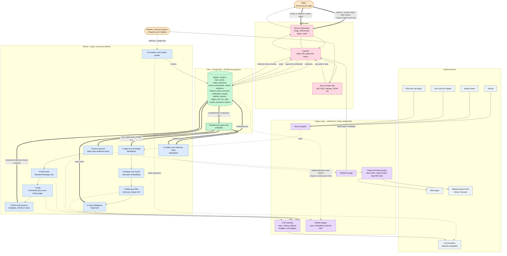

# SignalForge: Product Requirements & Architecture Baseline

**Status:** Final baseline for V1 development
**Version:** 1.2
**Date:** 2026-09-20
**Supersedes:** PRD v0.1, v0.2, v1.1

> **Naming note:** "SignalForge" is a working name. It is already used by unrelated companies, so trademark, domain and brand checks are required before any public launch.
>
> **Tagline (working):** Discover what matters. Know what's next.

### What changed from v1.1

- Product half (Part A) rewritten to reflect all agreed decisions: AI-engineering vertical, editor-in-the-loop funnel, 1 article/day, two editor reviews, trust ramp, information-gain differentiation, authorship policy.
- Restored the artifact catalog, DB tables, topic card spec, vertical config, scheduling and stage details (Part B).
- **Unified claim-status enum** (5 statuses) with explicit publication policy.
- Pipeline diagram fixed to show both human gates; **SEO/structuring now runs before editor approval** (new `structured` state).
- Idempotency key now uses a **stage-scoped config hash**, not a global config version.
- Search default changed: **direct fetch + optional paid providers first; SearXNG optional/later**.
- Added starter quality rubric, proposed budgets, and phase exit criteria.
- Removed broken citation tokens, fixed numbering, trimmed deferred material into a clearly marked list.

---

# PART A: PRODUCT

## 1. Product Definition

**SignalForge is an autonomous AI-technology intelligence platform that continuously discovers emerging signals in AI engineering, surfaces what may matter to an editor, researches selected topics from evidence, and publishes verified, high-quality knowledge for builders and AI systems.**

Core loop:

> **Observe → Detect → Understand → Select → Research → Verify → Explain → Structure → Publish → Learn**

The product is not fundamentally an AI writer. **The article is the output. The intelligence system behind it is the product.**

## 2. Vision and Thesis

> Help builders and AI systems understand what matters in AI engineering before it becomes obvious.

The valuable part of technical publishing is not generating text. It is discovering meaningful developments, deciding what matters, researching them from reliable evidence, and representing the result clearly and traceably.

Long-term, the publication is one interface over a continuously maintained knowledge layer (claims, evidence, entities, relationships). V1 builds the publication and preserves the data needed for that layer; it does not build the layer.

## 3. Problem

- Too many signals; high noise-to-signal ratio.
- Coverage is repetitive, shallow or vendor-driven.
- Niche but important developments are under-covered.
- Research is scattered across repos, docs, papers, changelogs and discussions.
- AI-generated content makes it hard to tell researched work from derivative summaries.
- AI systems increasingly consume content, but most articles are not structured for them.

The product solves **information selection and structuring**, not merely writing.

## 4. Scope Decisions

| Area | Decision |
|---|---|
| Vertical (V1) | **AI engineering for builders:** LLM apps, agents, RAG, inference/serving, evals, MCP, developer tooling, open models |
| Later verticals | Hardware, broader tech, etc. Added as **configuration**, not rewrites |
| Discovery breadth | Wide ingest; narrow publication |
| Content mix | **Evergreen-heavy** (how it works, tradeoffs, when not to use). Fast news is a minimal share |
| Audience | Primary: developers and AI engineers. Secondary: eng managers, founders, technical leaders. Machine: AI agents and AI search |
| Cadence | **1 article/day**, configurable up to 3+ without code changes |
| Selection | **Editor picks** from ~40-50 topic cards per night |
| Review | Two editor touchpoints (Sec. 9) |
| Authorship | Not advertised; published under the brand; no fake human persona; no fabricated first-person claims (Sec. 7) |
| Publishing | Own Next.js site is the CMS |
| Machine readability | Clean HTML, JSON-LD, RSS, sitemap in V1. Graph and public APIs deferred |

**Why narrow:** a new domain cannot win broad queries against established outlets. Topical focus builds authority faster for search engines and LLM retrieval, and keeps editorial judgment measurable.

## 5. Audience

- **Developers and AI engineers:** want to understand new tools, techniques, papers, open-source projects and infrastructure changes affecting how they build.
- **Technical leaders and founders:** want concise, technically meaningful understanding.
- **AI agents and AI search:** need definitions, explanations, claims, evidence, sources, dates and structured facts. This is a design consideration, not a separate UI.

## 6. Positioning and Differentiation

Not positioned as "an AI-generated technology blog." Positioned as **an evidence-backed AI-engineering intelligence publication for humans and AI systems.**

**Information gain** is the differentiator: each article must offer something the top search results do not. In order of strength:

1. **Executed experiments** (code run in a sandbox, benchmarks). Hardest to copy, most citable. *Roadmap item.*
2. **Cross-source synthesis** that surfaces conflicts and gaps between sources.
3. **Consistent structured analysis:** what changed, who it affects, tradeoffs, limitations.

Search engines emphasize helpful, reliable, people-first content and do not require special "AI-only" optimization. The goal is clear, attributable, reusable information, not gaming AI search.

## 7. Principles

1. **Quality over quota.** Skip a slot rather than publish weak content.
2. **Discovery is continuous; publishing is scheduled.**
3. **Research before writing.** The writer works from a structured research package, not the open web.
4. **Evidence before claims.** Important claims link to stored source text.
5. **Deterministic before LLM.** Use code, parsers and rules wherever reliable.
6. **Human judgment at the highest-leverage points:** topic selection and risk-focused draft review.
7. **Progressive autonomy and progressive optimization.** Build the full loop first, optimize from observed bottlenecks.
8. **Plug-in everything.** Sources, search, models, publisher, rankers, verticals and stages are replaceable without changing product logic.
9. **Standard, efficient engineering practices:** typed contracts, idempotency, observability, tests.
10. **Authorship policy.** The publication does not advertise AI authorship and does not use a fabricated human persona. The writer must not make first-person or experiential claims ("I tested this") unless an executed experiment in the research package supports them. Revisit disclosure policy, and any applicable requirements, as the site scales.

## 8. Core Loop and Topic Funnel

```text
Ingest (~500-2000 raw signals/day)
  -> Normalize, dedupe, cluster          [code + embeddings, no LLM]
  -> Relevance filter                    [rules + cheap model] -> ~100-200 clusters
  -> Topic intelligence                  [light research]      -> 40-50 topic cards/night
  -> EDITOR REVIEW 1: accept / reject (reason) / snooze / need-more-info
  -> Deep research                       [accepted topics only]
  -> Draft -> Verify -> SEO and structure
  -> EDITOR REVIEW 2: approve / revise / reject (risk summary)
  -> Scheduled publish -> live-page verification
  -> Analytics + citation tracking -> feedback into ranking
```

Every stage reads and writes a **typed, versioned artifact** (Part B).

## 9. Operating Model

- **Cadence:** 1 article/day by default; configurable up to 3+.
- **Editor time:** about 30-40 minutes per night.
  - Topic triage: ~15 min for 40-50 cards (~20 seconds per card).
  - Draft review: ~10 min per article via risk summary.
- **Two touchpoints:** night N picks topics; research, drafting, verification and structuring run in the background; night N+1 (or a short morning pass) reviews drafts. Publish times are scheduled for the audience's time zone, decoupled from review time.
- **Review trust ramp**
  1. First ~2 weeks: read every draft fully; log every error and compare against what the review summary flagged.
  2. When the summary catches most issues: summary plus spot-check.
  3. Permanently keep a **random full-read audit sample (~1 in 5)** to detect judge drift.
- **Skip rule:** if nothing meets the quality bar, the slot is skipped.
- **Backlog:** unpicked but good topics stay in a snoozed queue.
- **Fast lane (optional, later):** a rare-breaking-story path outside the nightly cycle.

## 10. Functional Requirements

### FR-01 Monitoring and Signal Collection
Configurable sources, starting with a small reliable set: GitHub releases/trending, Hacker News, arXiv and Hugging Face papers, official lab and framework blogs, RSS/Atom feeds, changelogs, selected communities (e.g. r/LocalLLaMA). Signals normalize to a common schema (`RawSignal`, Sec. 33). The initial release does not attempt to ingest the whole web.

### FR-02 Deduplication and Clustering
Multiple signals about the same event become one topic cluster (canonical URLs, content hashing, embedding similarity with entity overlap). This prevents duplicate research and wasted LLM calls.

### FR-03 Relevance Filter
Deterministic rules plus a cheap model reduce clusters to those relevant to the vertical. Escalate to stronger models only on low confidence.

### FR-04 Topic Intelligence and Topic Card
Light research on top candidates produces a **topic card** the editor can judge in about 20 seconds:

- One line: what happened
- Why it matters to AI builders (max 2 lines)
- Novelty: first seen, number of independent sources, primary-source link
- Signal strength: e.g. HN points, star velocity, discussion volume
- Coverage gap: what exists versus what nobody explains well
- Suggested angle and format (explainer, deep dive, comparison, experiment candidate)
- Evergreen versus news-decay estimate
- Confidence and risk flags (single source, vendor-claim only, unverified)
- Related clusters/angles

About **10-20% of the list are wildcards** outside the ranker's top picks, to avoid a feedback bubble.

### FR-05 Editorial Dashboard
Lightweight management UI (a spreadsheet or Notion is acceptable in the earliest days) with:

- Ranked topic cards; keyboard-first actions
- **Accept, reject (with reason tag), snooze, need-more-info** (triggers a deeper brief)
- Reason tags: too obvious, shallow, saturated, off-vertical, other
- Snoozed backlog
- Draft review view with claim-status highlighting and risk summary
- Pipeline status, failures, cost views, provenance

Every decision is stored as labeled data for future ranking.

### FR-06 Deep Research
Only accepted topics enter deep research: identify primary and high-quality secondary sources, extract and cross-check claims, record disagreements and gaps, store fetched documents and evidence spans, and produce a `ResearchPackage`.

### FR-07 Article Generation
The writer's input is the `ResearchPackage` only. Articles are clear, technical but accessible, specific and free of generic AI filler. Standard structure: title, summary, why it matters, context, what changed, technical explanation, examples, practical implications, limitations/tradeoffs, sources, related content. V1 formats: explainer, deep dive, comparison (experiment format on the roadmap).

### FR-08 Verification and Review Summary
1. Extract factual claims from the draft and map each to evidence.
2. **Mechanical check:** the cited span must exist in the stored document text.
3. **LLM judge** (different model family from the writer) checks whether the source supports the claim.
4. Assign each claim a status (Sec. 11).
5. Produce the **review summary**: uncertain/conflicting/unverified claims, single-source claims, judge-versus-mechanical disagreements, unsupported statements.
6. Log outcomes into the **per-model scorecard**; routing can shift away from models with high error rates.

### FR-09 SEO and Structuring
Separate, mostly deterministic capability: title and description options, slug, headings, search-intent alignment, internal links, related articles, canonical URL, structured and social metadata, JSON-LD. Runs **before** editor approval so the editor approves exactly what will be published. Any SEO-generated title/description/heading change passes a claim re-check. SEO never overrides accuracy.

### FR-10 Machine-Readable Publication (V1)
Semantic HTML, JSON-LD (Article plus sources and dates), RSS/Atom, sitemap, visible source references, publish and update timestamps. The data model retains **claim → evidence → source-document** links so richer layers can be added later.

### FR-11 Publishing
Transform to site format, generate metadata, upload assets, schedule, publish, revalidate, verify the live page, store canonical URL and metadata. **Idempotent** so retries never duplicate articles.

## 11. Claim Status Policy

One enum, used everywhere (research packages, verification, dashboard, DB constraint):

| Status | Meaning |
|---|---|
| `verified` | Quoted span exists in the stored source text **and** the judge confirms support **and** the source is primary, or at least two independent sources agree |
| `supported` | Span exists and the judge confirms support, but only a single non-primary source, or partial support |
| `uncertain` | Weak, indirect or insufficient evidence |
| `conflicting` | Credible sources disagree |
| `unverified` | No evidence found |

**Publication policy (V1):**

- Core claims must be `verified` or `supported`.
- `uncertain` / `unverified` claims must be removed, hedged in the text, or explicitly approved by the editor.
- `conflicting` claims must be presented as disputed with both sources cited, or removed.
- Any editor override is logged with a reason.

These rules are the initial definition of "verified" and should be calibrated during the two-week trust ramp.

## 12. Quality Gates and Starter Rubric

Before publication, an article passes:

- **Research:** sufficient primary sources; important claims supported.
- **Content:** clear thesis; useful and technically deep explanation; no obvious hallucination; no repetition.
- **Editorial:** still timely; adds value beyond existing coverage; fits the audience.
- **SEO/structure:** valid metadata, headings, internal links, canonical, JSON-LD.
- **Publishing:** working links, correct assets, live-page verification.

**Starter rubric (draft, to calibrate in weeks 1-2).** The editor scores each reviewed draft 1-5:

| Dimension | Publishable bar |
|---|---|
| Accuracy (claims vs evidence) | No unresolved core-claim issues (Sec. 11) |
| Information gain | ≥ 4: offers something top results lack |
| Technical depth | ≥ 3 |
| Clarity and structure | ≥ 3 |
| Sources | ≥ 1 primary source; all links working |

**Proposed budgets (to confirm):** per topic (research) ≈ $0.50, per article (all stages) ≈ $1.50, with a monthly infra + inference cap to be set by the owner.

## 13. Autonomy Levels

- **L0** research assistance
- **L1** automated research + drafting
- **L2 (V1)** research + drafting + human topic selection + human draft approval
- **L3** automated publishing after quality gates
- **L4** continuous operation, article maintenance, feedback learning

Autonomy increases only after measured quality supports it.

## 14. Metrics and Analytics

**Discovery:** signals/day, clusters/day, duplicate rate.
**Editorial:** cards reviewed, accept rate, reject reasons, decision time per card, wildcard hit rate, session length.
**Research/content:** sources per topic, primary-source ratio, verified-claim ratio, unsupported-claim rate, editor revision/rejection rate, cost per topic and per article.
**System:** end-to-end success rate, stage failure rate, latency, cache hit rate, LLM and search cost.
**Distribution:** impressions, clicks, CTR, organic traffic, referrals, returning readers.
**AI visibility (slow signal, low priority early):**

- Referral traffic from AI products plus Search Console
- Server logs of AI crawlers (a crawl is not a citation)
- A **probe harness**: periodically ask multiple LLMs/search APIs questions the articles answer and check whether the domain is cited

Uncited use is invisible, and volume will be low early on. Attribute results to topic category, format, style and depth to inform selection.

**Primary cost metric:** cost per successfully published high-quality article.
**Product north star:** number of high-value insights discovered, researched, published and consumed.

## 15. V1 Scope

**In scope**

- One vertical (AI engineering), small reliable source set
- Wide-to-narrow funnel, topic cards, dashboard with decision tags
- Deep research with evidence store, drafting, verification with review summary
- SEO/structuring, JSON-LD, RSS, sitemap, own-site publisher
- OpenAI-compatible LLM gateway (OpenRouter first), search abstraction (direct fetch first)
- Plug-in interfaces, provenance/audit trail, basic metrics

**Deferred (design for, do not build)**

- Claim/evidence graph and entity/concept ontology
- Topic/Concept/public knowledge APIs and MCP interface
- Automatic article updates from research deltas
- Analytics-driven automatic topic selection
- Executed-experiment pipeline (roadmap, highest information-gain feature)
- Additional verticals and additional publishing targets
- Editorial Agent / Knowledge Architect as separate agents

**Non-goals for V1:** monitoring the whole internet; full autonomy; guaranteed ranking; quota-driven publishing; browser-automation-heavy scraping; a fake human persona; sophisticated self-learning.

## 16. V1 Success Criteria

The loop is proven when the system can:

1. Ingest signals continuously and merge duplicates correctly.
2. Produce topic cards the editor finds useful (accept rate, time-to-decision).
3. Build evidence-backed research packages.
4. Produce drafts requiring limited edits.
5. Catch unsupported claims (compare summary flags versus editor-found errors).
6. Publish reliably and idempotently.
7. Keep an auditable record for every article.

**Suggested 90-day bar (not traffic):** ~1 article/day consistently, indexed pages, first AI-product referrers, a few external citations, falling editor rejection rate, and a review summary trusted enough to move to spot-check mode.

## 17. Risks

| Risk | Mitigation |
|---|---|
| Generic content / no ranking | Narrow vertical, information-gain focus, evergreen mix, editor topic selection, a parallel distribution channel (newsletter/community) since SEO is slow |
| Scaled low-value content penalties | Quality over quota, skip rule, human review, original insight |
| Incorrect information | Mechanical span check, cross-family judge, provenance, review summary, audit sampling |
| Circular verification | Verify against stored source text, not another LLM's summary |
| Editor bottleneck | Cap cards, filter upstream, snoozed backlog, ~1 article/day |
| Ranker echo chamber | Wildcard slice, reason-tag feedback |
| Unreliable search sources | Direct retrieval, APIs/RSS, multiple providers |
| Cost growth | Staged funnel, routing, caching, per-task budgets |
| Runaway agent loops | Iteration, token and time limits |
| Prompt injection via fetched content | Untrusted-input rules (Sec. 39) |
| Source licensing/attribution | Attribution policy, no wholesale copying, honor source terms |
| Over-engineering | Typed artifacts and plug-in seams now; deferred items only when needed |

## 18. Open Questions (remaining)

1. Final V1 source list for AI engineering.
2. Model IDs per role (paid provider list) and the monthly budget cap.
3. Dashboard auth (Supabase Auth versus simple JWT).
4. Queue library final choice (Procrastinate versus Arq), including behavior behind Supabase pooling.
5. Embedding model and host (local CPU versus API).
6. Storage for large research documents (Postgres versus object storage).
7. Publish windows and target audience time zone.
8. Parallel distribution channel (newsletter, HN, LinkedIn).
9. Sandbox design for future executed experiments.
10. AI-disclosure policy at scale; trademark/domain check for the name.

## 19. Decision Log

| Decision | Detail |
|---|---|
| Vertical | AI engineering for builders; others later as config |
| Content mix | Evergreen-heavy; fast news minimal |
| Funnel | Wide ingest, narrow publication; editor picks from ~40-50 cards |
| Cadence | 1 article/day, extensible to 3+ via config |
| Review | Two touchpoints; trust ramp; permanent audit sample |
| SEO placement | Before editor approval; claim re-check on SEO changes |
| Claim statuses | Five-value enum with publication policy |
| Verification | Mechanical span check, cross-family judge, per-model scorecard |
| Machine readability | HTML, JSON-LD, RSS, sitemap now; graph and APIs deferred |
| Authorship | Not advertised; brand-published; no fabricated first-person claims |
| Architecture | Modular monolith, plug-in seams, typed artifacts |
| LLM access | One OpenAI-compatible gateway; providers and roles are config |
| Search | Abstraction; direct fetch first, paid providers optional, SearXNG optional/later *(changed from v1.1)* |
| Metrics | Include AI-referrer, crawler and probe-based citation tracking |
| Quality vs quota | Skip a slot rather than publish weak content |

---

# PART B: ARCHITECTURE

## 20. Architecture Decision

SignalForge V1 is a **modular monolith in a monorepo**, not microservices.

Runtime:

- One Python codebase
- One FastAPI API process
- One Python worker process
- One Next.js application
- One PostgreSQL database
- A PostgreSQL-backed job queue/scheduler

Modules communicate through explicit interfaces and typed artifacts, so any module can be extracted later without redesign.

**Why:** V1 has one editor, one product and low operational scale. The complexity is in intelligence and reliability, not distributed systems. Keep runtime infrastructure boring and module boundaries strong.

## 21. System Shape

```text
                       ┌─────────────────────────┐
                       │         EDITOR          │
                       │     30-40 min/night     │
                       └────────────┬────────────┘
                                    │
                                    ▼
┌────────────────────────────────────────────────────────────────────────┐
│                       SIGNALFORGE APPLICATION                          │
│                                                                        │
│  ┌──────────────────┐                   ┌─────────────────────────┐    │
│  │     Next.js      │────── HTTPS ─────►│        FastAPI          │    │
│  │ Public Site +    │                   │ Editor API, Public API, │    │
│  │ Editor Dashboard │                   │ Webhooks                │    │
│  └──────────────────┘                   └───────────┬─────────────┘    │
│                                                     │                  │
│                                                     ▼                  │
│                                         ┌─────────────────────────┐    │
│                                         │       PostgreSQL        │    │
│                                         │ JSONB + pgvector + Jobs │    │
│                                         └───────────┬─────────────┘    │
│                                                     │                  │
│                                                     ▼                  │
│                                         ┌─────────────────────────┐    │
│                                         │         Worker          │    │
│                                         │  Pipeline + Stages      │    │
│                                         └───────────┬─────────────┘    │
│                                                     │                  │
│              Source Plugins   Search Plugins   LLM Gateway   Publisher │
└────────────────────────────────────────────────────────────────────────┘
```

## 22. Detailed Pipeline

Thick arrows are the main flow, dotted arrows are plugin dependencies and feedback. Both editor gates are shown; SEO/structuring runs before review 2.



## 23. Repository Structure

```text
signalforge/
├── apps/
│   ├── api/                 # FastAPI entrypoint, routers, auth, DTOs
│   ├── worker/              # worker + scheduler entrypoint
│   └── web/                 # Next.js public site + dashboard
│
├── src/signalforge/
│   ├── core/
│   │   ├── artifacts/       # Pydantic typed/versioned artifacts
│   │   ├── stage.py         # Stage interface + runner
│   │   ├── pipeline.py      # orchestration + state transitions
│   │   ├── registry.py      # plugin registry
│   │   ├── config.py        # settings + vertical configuration
│   │   ├── budget.py        # cost/token/search budgets
│   │   ├── provenance.py    # production lineage
│   │   └── errors.py
│   ├── plugins/
│   │   ├── sources/         # github, hn, rss, arxiv, hf
│   │   ├── search/          # direct_fetch, tavily, firecrawl, searxng
│   │   ├── llm/             # gateway, routing, fallbacks, capability flags
│   │   ├── rankers/         # rules, embeddings, learned later
│   │   └── publishers/      # owned-site publisher
│   ├── stages/              # ingest, cluster, filter, topic_intel, research,
│   │                        # write, verify, seo, publish, analytics
│   ├── db/                  # models, repositories, migrations
│   └── verticals/
│       └── ai_engineering.yaml
├── tests/                   # unit, contract, golden, e2e
└── infra/                   # Dockerfiles, railway config
```

## 24. Plug-in Contracts

External dependencies sit behind interfaces (Python `Protocol`s in `core/`).

```python
class Source(Protocol):
    name: str
    def fetch(self, since: datetime) -> Iterable[RawSignal]: ...

class SearchProvider(Protocol):
    name: str
    def search(self, query: str, limit: int) -> list[SearchHit]: ...
    def fetch(self, url: str) -> Document: ...

class LLMGateway(Protocol):
    def complete(self, role: str, messages: list[Message],
                 schema: type[T] | None = None,
                 budget: Budget | None = None) -> Result[T]: ...

class Ranker(Protocol):
    def score(self, cluster: Cluster, ctx: RankContext) -> Score: ...

class Publisher(Protocol):
    def publish(self, article: ArticleArtifact, when: datetime) -> PublishRecord: ...
    def verify(self, record: PublishRecord) -> bool: ...

class Stage(Protocol):
    name: str
    input_type: type[Artifact]
    output_type: type[Artifact]
    def run(self, input: Artifact, ctx: StageContext) -> Artifact: ...
```

**Rules**

1. Stages depend on protocols, never on concrete providers.
2. Stages never call LLM providers directly.
3. Search goes through the search abstraction.
4. Provider selection is configuration-driven.
5. A new source or provider requires an implementation plus configuration, not pipeline changes.

## 25. LLM Gateway

One **OpenAI-compatible client interface**. Providers are configuration, not pipeline code. Any new OpenAI-compatible API is one config entry.

```yaml
providers:
  openrouter:
    base_url: https://openrouter.ai/api/v1
    api_key_env: OPENROUTER_API_KEY
  local_ollama:                     # optional, small models only (<= 8B)
    base_url: http://localhost:11434/v1
    api_key_env: null

models:
  cheap_classifier: { provider: openrouter, model: <model-id>, caps: { json: true, tools: false, ctx: 32000 } }
  writer:           { provider: openrouter, model: <model-id>, fallback: [] }
  judge:            { provider: openrouter, model: <different-family-model-id> }

roles:                              # stages reference roles, never model names
  relevance_filter: cheap_classifier
  topic_card: cheap_classifier
  research_synthesis: writer
  article_draft: writer
  claim_verify: judge

budgets:
  per_topic_usd: 0.50
  per_article_usd: 1.50
```

Model IDs are placeholders until the model list is decided. Compatibility is not identical across providers, so the gateway keeps capability metadata (JSON mode, tools, context) and validates every output.

**Gateway responsibilities:** provider and model routing, capability checks, retries with exponential backoff, fallback chains, token and cost limits, structured-output validation (Pydantic plus retry), model-family constraints, per-call logging, latency and cost tracking.

**Rule:** the pipeline says `role = "article_draft"`, never `model = "..."`. The gateway enforces **writer model family ≠ judge model family** (startup check).

## 26. Search / Retrieval

Search is provider-agnostic. Discovery mostly comes from feeds and APIs, not search; search supports research.

```text
SearchProvider
   ├── direct_fetch      # default: fetch known URLs + local extraction (e.g. trafilatura)
   ├── tavily            # optional paid, plug-in
   ├── firecrawl         # optional paid, for hard pages, plug-in
   ├── searxng           # optional, later
   └── (source APIs: github, hn, arxiv, hf, rss are Source plugins)
```

Default V1 order: **direct fetch → Tavily/Firecrawl (optional, paid) → SearXNG (later, if needed).** SearXNG is a self-hostable metasearch aggregator; it is not a guarantee of stable access to underlying engines (rate limits, blocking) and adds a service to operate, so it is never a hard dependency. Verify current provider limits before relying on any free tier.

## 27. Database and Queue

**PostgreSQL is the system of record.** Supabase Postgres is acceptable for V1; application code uses plain PostgreSQL semantics via SQLAlchemy and Alembic, and avoids Supabase-specific SDKs beyond (optionally) auth, so moving to AWS RDS is a connection-string change. Mind pooler modes with prepared statements.

Use JSONB for flexible artifacts, pgvector for embeddings and similarity, and real columns for frequently queried fields.

PostgreSQL documents `FOR UPDATE SKIP LOCKED` as suitable for queue-like tables with multiple consumers.

**Job record (minimum):**

```text
id, job_type, entity_id, status, priority, available_at, attempts,
lease_until, idempotency_key, config_hash, last_error, created_at, updated_at
```

The queue sits behind a `JobQueue` abstraction. The initial implementation may use a PostgreSQL-backed library such as Procrastinate.

## 28. Business State vs Job State

These remain separate.

**Business state**

```text
proposed, accepted, researching, researched, drafting, drafted,
verifying, verified, structuring, structured,
approved, scheduled, published, live_verified, monitoring
(terminal/side states: rejected, snoozed, need_more, failed)
```

**Job state**

```text
queued, leased, running, succeeded, retrying, failed, dead_lettered
```

A failed job must never implicitly move business state into an invalid state. The pipeline engine owns business-state transitions.

## 29. Idempotency

Stage idempotency key:

```text
(stage, entity_id, input_hash, stage_config_hash)
```

`stage_config_hash` is a hash of only the configuration that stage depends on (its prompt/version, its role's model routing, relevant ranking weights, artifact schema version). A global config version is **not** used, because any unrelated config tweak would rerun everything.

This lets a stage intentionally rerun when its prompt, routing, weights, logic or schema changes. Re-running with an identical key returns the cached result, since LLM output is not deterministic.

Publishing uses `article_id + article_version` as its external idempotency key.

## 30. Provenance and Replayability

Every article is reconstructable:

```text
Signal → Cluster → TopicCard → EditorDecision → ResearchPackage
→ Claims + Evidence → Draft → VerificationResult → StructuredDraft
→ Approval → PublishRecord
```

Every artifact stores `id`, `schema_version`, `created_at`, `produced_by`, `parent_ids`.

Every stage run stores stage, input and output artifact/version, `stage_config_hash`, model/provider where relevant, timing, token and cost information, errors and retries.

The system must answer: **"Why was this article published?"** and **"What evidence and decisions produced this sentence?"**

## 31. Evidence Storage

Evidence references a **versioned fetched document**, not merely a URL.

```text
SourceDocument: url, canonical_url, fetched_at, content_hash,
                extracted_text, source metadata, retention policy
Evidence:       document_id, quoted_span, start_offset, end_offset, document_hash
```

This enables deterministic mechanical verification even if the live source later changes or disappears. Storage and retention must respect source terms and licensing. Fetched pages are not permission to republish their content.

## 32. Artifact Versioning

Every artifact schema is versioned (`TopicCard v1`, `TopicCard v2`). Old runs remain readable, and schema migrations never silently rewrite historical artifacts.

## 33. Artifact Catalog

Common fields: `id`, `schema_version`, `created_at`, `produced_by` (stage run id), `parent_ids`.

| Artifact | Key fields |
|---|---|
| `RawSignal` | source, canonical_url, title, published_at, source_type, summary, entities, topics, metadata, content_hash |
| `Cluster` | signal_ids, centroid_embedding, first_seen, primary_source_url, entity_tags |
| `TopicCard` | cluster_id, what_happened, why_it_matters, novelty, signal_strength, coverage_gap, suggested_angle, format, evergreen_score, confidence, risk_flags[], score, wildcard |
| `EditorDecision` | topic_card_id, decision (accept/reject/snooze/need_more), reason_tag, note, decided_at |
| `ResearchPackage` | topic_id, core_question, what_changed, why_it_matters, timeline[], claims[], sources[], entities[], concepts[], open_questions[], angles[] |
| `Claim` | id, text, status (Sec. 11 enum), evidence[] |
| `Evidence` | claim_id, document_id, quoted_span, offsets, document_hash |
| `Draft` / `ArticleVersion` | article_id, version, markdown, structured_sections, claim_map, model_trail |
| `VerificationResult` | draft_id, per_claim {mechanical_ok, judge_verdict, status, notes}, review_summary |
| `StructuredDraft` | draft_id, seo metadata, slug, JSON-LD, internal links, post-SEO claim recheck result |
| `EditorReview` | draft_id, decision (approve/revise/reject), notes, overrides[] with reasons, audit_sample flag |
| `PublishRecord` | article_id, version, canonical_url, published_at, verified_live, idempotency_key |

## 34. Database Schema

| Group | Tables |
|---|---|
| Discovery | `sources`, `signals`, `clusters`, `cluster_signals` |
| Editorial | `topic_cards`, `editor_decisions`, `editor_reviews` |
| Research | `source_documents`, `research_packages`, `claims`, `evidence` |
| Content | `articles`, `article_versions`, `verification_results`, `structured_drafts`, `publish_records` |
| Ops | `jobs`, `stage_runs`, `llm_calls`, `model_scorecard`, `config_snapshots` |
| Metrics | `referral_events`, `crawler_hits`, `citation_probes`, `page_metrics` |

**Conventions**

- UUID primary keys; `created_at` / `updated_at`; soft delete only where needed.
- JSONB for flexible artifact payloads; promote fields to columns when queried or filtered.
- `claims.status` is a constrained enum matching Sec. 11.
- pgvector indexes on `signals.embedding` and `clusters.centroid`.
- Key indexes: `signals(canonical_url)`, `signals(content_hash)`, `topic_cards(status, score)`, unique `stage_runs(stage, entity_id, input_hash, stage_config_hash)`.
- Every artifact row stores `schema_version`; migrations via Alembic.

## 35. State Machine

```text
Signal → Cluster → TopicCard: proposed
   ├── rejected
   ├── snoozed
   ├── need_more  → (deeper brief) → proposed
   └── accepted
         ↓
     researching → researched
         ↓
      drafting → drafted
         ↓
      verifying → verified
         ↓
     structuring → structured      (SEO, JSON-LD, links, post-SEO claim recheck)
         ↓
   [EDITOR REVIEW 2]
         ├── revise   → drafting (with editor notes)
         ├── rejected
         └── approved
                 ↓
             scheduled → published → live_verified → monitoring
```

Only the pipeline engine performs transitions. Every transition writes a `stage_run`. Failures move an entity to `failed` with a reason visible on the dashboard; they are never silently skipped.

## 36. Scheduling

| Job | Frequency | Purpose |
|---|---|---|
| Ingest | every 30-60 min | pull sources, normalize, dedupe |
| Cluster + filter | after ingest | merge, relevance filter |
| Topic-card build | nightly, before the editor's review time | top 40-50 cards incl. wildcards |
| Research → draft → verify → structure | triggered on accept | background, budget-capped |
| Publish scheduler | configured windows | publishes approved articles at audience-friendly times |
| Analytics / probes | daily | referrers, crawler hits, citation probes |

## 37. Stage Details

| Stage | Type | Notes |
|---|---|---|
| ingest | code | source plugins, canonical URL, hashing |
| cluster | code + embeddings | cosine threshold plus entity overlap; no LLM |
| filter | rules + cheap LLM | escalate only on low confidence |
| topic_intel | cheap/medium LLM + code | builds `TopicCard`; pulls signal-strength metrics from APIs |
| research | strong LLM + fetch/search | primary sources first; stores documents and spans |
| write | strong LLM | input is `ResearchPackage` only |
| verify | code + judge LLM | mechanical span check, then judge; builds review summary |
| seo | mostly code | metadata, slug, links, JSON-LD; LLM only for title/description options; claim recheck on changes |
| publish | code | write to DB, revalidate Next, verify live page |
| analytics | code | metrics ingestion, citation probes |

## 38. Frontend / API Boundary

Next.js **never accesses the database directly**.

```text
Next.js → HTTPS → FastAPI → Repositories → PostgreSQL
```

**FastAPI:** `/editor/*` (authenticated), `/public/*` (read-only, cacheable), `/hooks/*` (revalidate, webhooks).

**Next.js public site:** article pages (ISR/revalidation for pre-rendered HTML with updates without full rebuilds), topic/tag pages, RSS/Atom, sitemap, JSON-LD.

**Dashboard:** keyboard-first topic triage, draft review with claim-status highlighting, risk summary, snoozed backlog, pipeline status and failures, costs, research provenance.

## 39. Security and Trust Boundaries

Fetched web content is **untrusted input**. Assume it can contain prompt injection.

- Fetched content is passed to models as delimited data.
- Fetched content cannot define or modify available tools.
- Fetched content cannot directly trigger side effects.
- Publishing requires explicit application-level authorization.
- Secrets stay outside model context; tool execution is controlled by the application.
- HTML is sanitized before rendering.
- Public endpoints are rate-limited; editor endpoints are authenticated.
- Respect robots.txt and source terms; store attribution; never reproduce large source passages in articles.

## 40. Observability

**LLM call:** request_id, stage_run_id, role, provider, model, model_family, input/output/cached tokens, cost, latency, success/failure.
**Stage run:** stage, entity, input_hash, stage_config_hash, started/finished, status, retry_count, error.
**Product-level:** cost per topic and article, time signal→card, time signal→publication, editor acceptance rate, verification failure rate, revision rate.

Optimize from measured bottlenecks, not assumptions. Use structured logs plus LLM tracing (e.g. Langfuse) from day one.

## 41. Testing Strategy

- **Unit:** canonicalization, hashing, dedupe, clustering, state transitions, budgets, idempotency, mechanical span verification.
- **Contract:** every plugin tested against its Protocol using recorded fixtures.
- **Golden:** fixed inputs validate artifact schemas, topic cards, verification outputs and prompts where appropriate.
- **LLM evals:** small labeled sets for relevance filtering, topic-card usefulness, claim verification, information-gain assessment (seeded from editor decisions).
- **End-to-end:** full pipeline with mocked external providers.

## 42. Deployment

Initial target: **Railway** with `api`, `worker`, `web` and `scheduler`, all Dockerized, configuration via environment variables, migrations as a release step. Avoid Railway-specific runtime dependencies so a later move to AWS (e.g. ECS/App Runner + RDS) stays cheap. Move only for a concrete reason (cost, compliance, scale).

## 43. Build Order and Exit Criteria

| Phase | Scope | Exit criteria (targets to calibrate) |
|---|---|---|
| 1 Foundation | monorepo, config, Postgres + Alembic, artifact models, stage runner, state machine, job queue, LLM gateway, logging/budgets | A no-op pipeline runs end to end through the queue; `stage_runs` and `llm_calls` are recorded; budgets enforced; migrations apply cleanly |
| 2 Discovery | GitHub, HN, RSS, arXiv/HF; normalization, canonicalization, dedupe, clustering | ≥ 4 sources ingesting continuously for 7 days; duplicate rate measured; clustering spot-checked on a ~50-cluster labeled sample |
| 3 Topic Intelligence | relevance filter, topic cards, dashboard, editor decisions, reason tags, wildcards | **Run ~2 weeks nightly.** Answer: are the cards useful? Tracked by decision time per card, accept rate, and the editor's own verdict. *Do not build further until this passes.* |
| 4 Research | search abstraction, direct retrieval, extraction, source documents, claims, evidence spans, research packages | Packages contain stored documents and spans; mechanical span check works on real samples |
| 5 Content | writer, verification, review summary, editor approval | Trust-ramp logging in place (summary flags vs editor-found errors) |
| 6 Publication | SEO/structuring, semantic HTML, JSON-LD, publisher, ISR/revalidation, RSS, sitemap | Idempotent publish; live-page verification passes; indexed pages |
| 7 Analytics | referrals, crawler hits, article metrics, citation probes | Dashboards and probe harness running |
| 8 Optimization | routing, caching, research reuse, delta research, learned ranker, stage consolidation | Cost per article trending down without quality loss |
| 9 Increased autonomy | automatic selection, reduced review, autonomous publishing, article maintenance | Only after sustained quality evidence |

## 44. Final Architecture Decisions

| Area | V1 Decision |
|---|---|
| Architecture | Modular monolith, monorepo |
| Processes | API + Worker (Python), Next.js |
| Contracts | Pydantic + Python Protocols |
| Database | PostgreSQL (Supabase) with JSONB + pgvector |
| Queue / scheduler | PostgreSQL-backed queue + cron; no Redis, no Celery |
| Orchestration | Plain Python; no LangChain/LangGraph |
| LLM interface | One OpenAI-compatible gateway; providers and roles are config |
| Local model | Optional, small (≤ 8B), for embeddings/classification |
| Search | Abstraction; direct fetch first; paid providers optional; SearXNG optional/later |
| Evidence | Stored document version + hash + span |
| Claim statuses | verified / supported / uncertain / conflicting / unverified |
| Business state vs job state | Separate; pipeline-owned business state |
| Stage idempotency | stage + entity + input hash + stage-scoped config hash |
| Publish idempotency | article + version |
| SEO placement | Before editor approval |
| Frontend DB access | Forbidden |
| Artifacts | Typed and versioned |
| Provenance | Required |
| Knowledge graph, public APIs, MCP | Deferred |
| Executed experiments | Major roadmap item |
| Microservices | Deferred |
| Autonomy / cost optimization | Progressive |

## 45. Final Architectural Take

The architecture is deliberately **boring infrastructure around sophisticated product intelligence.** SignalForge does not need microservices, LangGraph, Redis, Kafka or a large multi-agent framework to prove itself. It needs:

```text
Reliable ingestion
      +
Good signal detection
      +
Useful topic cards
      +
Excellent research
      +
Strong verification
      +
Good editorial judgment
```

Modular boundaries let components be optimized or extracted later without paying the operational cost today.

This document is the **V1 development baseline.** The queue/job-state separation, provenance and replayability, stage-scoped idempotency, and the explicit untrusted-content security boundary are mandatory.
